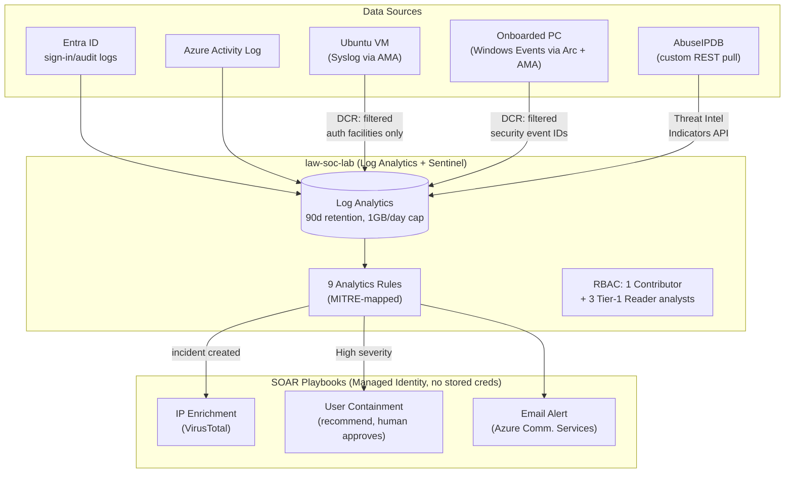

# sentinel-soc-lab

Infrastructure-as-code for a personal Microsoft Sentinel SOC lab, deployed and operated end-to-end from scratch (no pre-existing workspace or connectors) to build hands-on depth in Sentinel deployment, connector configuration, and detection engineering.

## Architecture



## What's deployed

- **Workspace**: `law-soc-lab`, `uaenorth`, 90-day retention (free via Sentinel), 1 GB/day ingestion cap
- **Connectors**: Azure Activity Log, Entra ID (sign-in + audit + risk events), Syslog (dedicated VM, DCR-filtered to security-relevant facilities/severities), Windows Security Events (personal PC onboarded via Azure Arc, DCR-filtered to high-value event IDs), custom AbuseIPDB threat intel pipeline
- **Analytics rules**: 9 scheduled rules, all matched to connectors actually deployed — no template dumped in blind. MITRE ATT&CK mapped. See [`cybersoc-portfolio/analytics-rules`](https://github.com/TaruntejaDesireddy/cybersoc-portfolio/tree/main/analytics-rules)
- **RBAC**: owner (Sentinel Contributor) + 3 simulated Tier-1 analyst accounts (Sentinel Reader only)
- **SOAR playbooks**: see [`cybersoc-portfolio/playbooks`](https://github.com/TaruntejaDesireddy/cybersoc-portfolio/tree/main/playbooks)

## Step-by-step build log

[`SETUP.md`](SETUP.md) — the actual sequence used to build this from an empty subscription, including the real errors hit (VM Managed Identity gotchas, Graph permission scoping, CLI extension quirks) and how they were fixed. Written as a build log, not a cleaned-up happy path.

## Deploying (`/bicep`)

```bash
az group create --name rg-soc-lab --location uaenorth

az deployment group create --resource-group rg-soc-lab --template-file bicep/main.bicep \
  --parameters adminObjectId=<your-aad-object-id>

WORKSPACE_ID=$(az deployment group show -g rg-soc-lab -n main --query properties.outputs.workspaceId.value -o tsv)

az deployment group create --resource-group rg-soc-lab --template-file bicep/dcr-syslog.bicep \
  --parameters workspaceResourceId=$WORKSPACE_ID

az deployment group create --resource-group rg-soc-lab --template-file bicep/dcr-windows-events.bicep \
  --parameters workspaceResourceId=$WORKSPACE_ID
```

Data connector diagnostic settings (Activity Log, Entra ID) are tenant/subscription-scoped and deployed separately via `az monitor diagnostic-settings` — not included in the Bicep since they're not resource-group-scoped resources.

## Cost design notes

Every ingestion source here was deliberately filtered before deployment, not capped after the fact:
- Syslog DCR uses a `transformKql` to drop everything except auth-relevant facilities at warning severity+
- Windows Events DCR uses `xPathQueries` to pull only 9 specific high-value event IDs, not the full Security log
- Workspace daily quota set to the practical minimum for a single-user lab

This keeps a real multi-source SOC lab within a very small ingestion budget.

## The Linux syslog endpoint is on-demand, not always-on

`vm-syslog-01` does not run permanently. A B1s VM with a Standard public IP and Premium SSD disk costs ~$18.54/month if left running 24/7 — most of a personal lab's entire monthly budget for one syslog forwarder. Deploy it only when you want to test or demonstrate the 5 Linux Sentinel rules, generate the telemetry you need, then tear it down:

```bash
./deploy-syslog-vm.sh <your-current-ip>
# ... test, generate SSH brute-force attempts, verify the rules fire ...
./teardown-syslog-vm.sh
```

`teardown-syslog-vm.sh` deletes the VM, disk, NIC, public IP, and NSG — everything that bills. It leaves `dcr-syslog-soc-lab` in place, since that costs nothing idle and is what `deploy-syslog-vm.sh` reattaches to on the next run.
