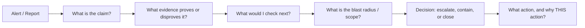

# L2 SOC Analyst Interview Preparation

535 questions from a face-to-face L2 SOC Analyst interview question bank, answered and organized for fast, effective study. Built from a 25-phase question bank covering SOC fundamentals, networking, Windows/AD, identity, email security, malware, MITRE ATT&CK, Microsoft Sentinel, KQL, Defender XDR, firewalls, Linux, incident-response scenarios, cloud security, detection engineering, automation, and behavioral/L2-thinking questions.

**Start here → [`00-CRAM-SHEET.md`](00-CRAM-SHEET.md)** — the highest-yield, last-hour summary: diagrams, tables, and KQL snippets you should be able to redraw/recite from memory.

## How to study this if you're short on time

Don't read question → memorized answer. The bank itself says it best: every answer here is built as

```
question → concept → evidence → investigation → decision → action
```

A weak (L1) answer states a fact. A strong (L2) answer shows how you'd *prove* it — what you'd check first, second, third, and when you'd escalate or contain. Interviewers at this level are listening for the investigation chain, not the definition.

### If you have 2-3 hours tonight
1. Read [`00-CRAM-SHEET.md`](00-CRAM-SHEET.md) fully — 30-40 min.
2. Read all **Tier 1** files below, focusing on the *investigation steps* and diagrams, not memorizing prose — 90 min.
3. Skim [`phase-25-l2-thinking-questions.md`](phase-25-l2-thinking-questions.md) — these are the follow-up probes that decide whether you sound like L1 or L2.

### If you have a full evening (6-8 hours)
Work Tier 1 → Tier 2 → Tier 3 in order, in one sitting per tier. Re-read the Cram Sheet again right before you sleep and again in the morning.

### Morning of the interview
Re-read `00-CRAM-SHEET.md` only. Do not try to learn anything new — consolidate.

## Priority tiers

The question bank itself weights the 535 questions unevenly. Use this to allocate your remaining time.

### Tier 1 — Must master (asked in nearly every L2 SOC interview)

| Phase | Topic | Questions | File |
|---|---|---:|---|
| 1 | SOC Fundamentals | 1–20 | [phase-01-soc-fundamentals.md](phase-01-soc-fundamentals.md) |
| 2 | Networking | 21–60 | [phase-02-networking.md](phase-02-networking.md) |
| 3 | Ports & Protocols | 61–84 | [phase-03-ports-protocols.md](phase-03-ports-protocols.md) |
| 4 | Windows Security & Event IDs | 85–120 | [phase-04-windows-security.md](phase-04-windows-security.md) |
| 5 | Processes & Endpoint Security | 121–150 | [phase-05-processes-endpoint.md](phase-05-processes-endpoint.md) |
| 6 | Active Directory Attacks | 151–170 | [phase-06-ad-attacks.md](phase-06-ad-attacks.md) |
| 7 | Identity & Entra ID | 171–194 | [phase-07-identity-entra-id.md](phase-07-identity-entra-id.md) |
| 8 | Email & Phishing | 195–217 | [phase-08-email-phishing.md](phase-08-email-phishing.md) |
| 11 | Microsoft Sentinel | 256–290 | [phase-11-microsoft-sentinel.md](phase-11-microsoft-sentinel.md) |
| 12 | KQL | 291–324 | [phase-12-kql.md](phase-12-kql.md) |
| 16 | Incident Response Scenarios | 370–400 | [phase-16-incident-response-scenarios.md](phase-16-incident-response-scenarios.md) |
| 17 | Advanced L2 Investigation | 401–420 | [phase-17-advanced-l2-investigation.md](phase-17-advanced-l2-investigation.md) |
| 25 | Questions Designed to Test L2 Thinking | 521–535 | [phase-25-l2-thinking-questions.md](phase-25-l2-thinking-questions.md) |

### Tier 2 — Strong knowledge expected

| Phase | Topic | Questions | File |
|---|---|---:|---|
| 9 | Malware | 218–237 | [phase-09-malware.md](phase-09-malware.md) |
| 10 | MITRE ATT&CK | 238–255 | [phase-10-mitre-attack.md](phase-10-mitre-attack.md) |
| 13 | Defender XDR / EDR | 325–340 | [phase-13-defender-xdr-edr.md](phase-13-defender-xdr-edr.md) |
| 14 | Network Security / Firewalls | 341–357 | [phase-14-firewalls-network-security.md](phase-14-firewalls-network-security.md) |
| 19 | Threat Intelligence | 436–446 | [phase-19-threat-intelligence.md](phase-19-threat-intelligence.md) |
| 20 | Cloud Security (Azure) | 447–465 | [phase-20-cloud-security.md](phase-20-cloud-security.md) |
| 21 | L2 Troubleshooting | 466–475 | [phase-21-l2-troubleshooting.md](phase-21-l2-troubleshooting.md) |
| 22 | Detection Engineering | 476–490 | [phase-22-detection-engineering.md](phase-22-detection-engineering.md) |

### Tier 3 — Know the concepts (won't anchor the interview, but gaps stand out)

| Phase | Topic | Questions | File |
|---|---|---:|---|
| 15 | Linux | 358–369 | [phase-15-linux.md](phase-15-linux.md) |
| 18 | SOC Operations | 421–435 | [phase-18-soc-operations.md](phase-18-soc-operations.md) |
| 23 | Automation / SOAR | 491–500 | [phase-23-automation-soar.md](phase-23-automation-soar.md) |
| 24 | Face-to-Face Behavioral Questions | 501–520 | [phase-24-behavioral-questions.md](phase-24-behavioral-questions.md) |

> Behavioral questions are the one category no one can pre-write for you — [phase-24](phase-24-behavioral-questions.md) gives you the STAR framework and fill-in templates. Spend 15 minutes mapping 4-5 of your own real incidents onto them **before** the interview, not during it.

## The one habit that separates L1 from L2

For *every* "how would you investigate X" question, force yourself through this chain before answering:



If your answer to any investigation question is one sentence, you're answering like L1. If it walks through evidence → scope → decision → business impact, you're answering like L2. See [phase-16](phase-16-incident-response-scenarios.md) and [phase-25](phase-25-l2-thinking-questions.md) for the fully worked version of this.

## Index of all 25 phases

| # | Phase | Questions | File |
|---:|---|---:|---|
| 1 | SOC Fundamentals | 1–20 | [phase-01-soc-fundamentals.md](phase-01-soc-fundamentals.md) |
| 2 | Networking | 21–60 | [phase-02-networking.md](phase-02-networking.md) |
| 3 | Ports & Protocols | 61–84 | [phase-03-ports-protocols.md](phase-03-ports-protocols.md) |
| 4 | Windows Security | 85–120 | [phase-04-windows-security.md](phase-04-windows-security.md) |
| 5 | Processes & Endpoint Security | 121–150 | [phase-05-processes-endpoint.md](phase-05-processes-endpoint.md) |
| 6 | Active Directory Attacks | 151–170 | [phase-06-ad-attacks.md](phase-06-ad-attacks.md) |
| 7 | Identity & Entra ID | 171–194 | [phase-07-identity-entra-id.md](phase-07-identity-entra-id.md) |
| 8 | Email & Phishing | 195–217 | [phase-08-email-phishing.md](phase-08-email-phishing.md) |
| 9 | Malware | 218–237 | [phase-09-malware.md](phase-09-malware.md) |
| 10 | MITRE ATT&CK | 238–255 | [phase-10-mitre-attack.md](phase-10-mitre-attack.md) |
| 11 | Microsoft Sentinel | 256–290 | [phase-11-microsoft-sentinel.md](phase-11-microsoft-sentinel.md) |
| 12 | KQL | 291–324 | [phase-12-kql.md](phase-12-kql.md) |
| 13 | Defender XDR / EDR | 325–340 | [phase-13-defender-xdr-edr.md](phase-13-defender-xdr-edr.md) |
| 14 | Network Security / Firewalls | 341–357 | [phase-14-firewalls-network-security.md](phase-14-firewalls-network-security.md) |
| 15 | Linux | 358–369 | [phase-15-linux.md](phase-15-linux.md) |
| 16 | Incident Response Scenarios | 370–400 | [phase-16-incident-response-scenarios.md](phase-16-incident-response-scenarios.md) |
| 17 | Advanced L2 Investigation | 401–420 | [phase-17-advanced-l2-investigation.md](phase-17-advanced-l2-investigation.md) |
| 18 | SOC Operations | 421–435 | [phase-18-soc-operations.md](phase-18-soc-operations.md) |
| 19 | Threat Intelligence | 436–446 | [phase-19-threat-intelligence.md](phase-19-threat-intelligence.md) |
| 20 | Cloud Security | 447–465 | [phase-20-cloud-security.md](phase-20-cloud-security.md) |
| 21 | L2 Troubleshooting | 466–475 | [phase-21-l2-troubleshooting.md](phase-21-l2-troubleshooting.md) |
| 22 | Detection Engineering | 476–490 | [phase-22-detection-engineering.md](phase-22-detection-engineering.md) |
| 23 | Automation / SOAR | 491–500 | [phase-23-automation-soar.md](phase-23-automation-soar.md) |
| 24 | Behavioral Questions | 501–520 | [phase-24-behavioral-questions.md](phase-24-behavioral-questions.md) |
| 25 | Questions Designed to Test L2 Thinking | 521–535 | [phase-25-l2-thinking-questions.md](phase-25-l2-thinking-questions.md) |

Good luck.
