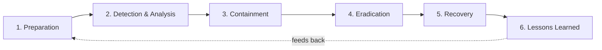
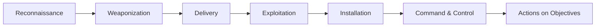

[← Back to index](README.md) | Tier 1 — Must master

# Phase 1 — SOC Fundamentals (Q1–20)

## 1. What is a SOC?
A Security Operations Center: the team and toolset (SIEM, EDR, ticketing, playbooks) that continuously monitors, detects, investigates, and responds to security events across an organization's environment. Its job is to shrink the time between "something bad happened" and "we know, we've scoped it, and we've acted."

## 2. What is the difference between L1, L2, and L3 SOC analysts?

| Level | Focus | Typical work |
|---|---|---|
| **L1** | Triage | First look at alerts, follows runbooks, classifies true/false positive, escalates what it can't resolve |
| **L2** | Investigation | Deep-dives escalated alerts, correlates multiple log sources, builds a timeline, decides containment, writes detections/tunes rules |
| **L3** | Expert response / engineering | Threat hunting, malware/forensic analysis, incident command on major incidents, detection engineering, mentors L1/L2 |

The boundary that matters in an interview: **L1 answers "what happened," L2 answers "why, how far, and what do we do about it."**

## 3. What is the responsibility of an L2 SOC analyst?
- Investigate incidents escalated from L1 with full context-gathering (identity, endpoint, network, email) rather than a single log source.
- Correlate related alerts into one incident, build a timeline, and identify root cause / initial access vector.
- Make and justify containment decisions (isolate host, disable account, block indicator) weighed against business impact.
- Tune analytics rules to cut false positives and close detection gaps found during investigations.
- Write clear incident documentation and hand off cleanly to L3/IR when scope exceeds L2 authority.
- Mentor L1 analysts and improve runbooks/playbooks from lessons learned.

## 4. Explain the incident response lifecycle.
Based on the NIST model — six phases, cyclical (lessons feed back into preparation):

- **Preparation** — tooling, logging coverage, runbooks, access, trained staff *before* anything happens.
- **Detection & Analysis** — alert fires or is reported; you validate, scope, and classify severity.
- **Containment** — stop the bleeding: isolate host, disable account, block IOC (short-term), then longer-term containment while planning eradication.
- **Eradication** — remove the root cause: malware, persistence mechanisms, attacker-created accounts.
- **Recovery** — restore systems to normal operation, monitor closely for reinfection/re-entry.
- **Lessons Learned** — post-incident review: what detection gap let this happen, what should change.

## 5. What is the difference between an event, alert, incident, and case?

| Term | Definition |
|---|---|
| **Event** | Any recorded activity (a logon, a process start, a DNS query) — most are completely benign |
| **Alert** | An event (or combination of events) that matched a detection rule and was flagged for review |
| **Incident** | One or more correlated alerts confirmed (or strongly suspected) to represent real malicious/policy-violating activity, now being actively investigated |
| **Case** | The formal record/container an incident (sometimes several related incidents) is tracked in through to closure — includes evidence, timeline, actions taken, and final disposition |

Escalation direction is one-way in scale: many events → some alerts → fewer incidents → a case.

## 6. What is the difference between a true positive, false positive, and benign positive?

| Type | Meaning | Action |
|---|---|---|
| **True Positive (TP)** | The alert is correct — malicious/unwanted activity genuinely occurred | Investigate, contain, respond |
| **False Positive (FP)** | The alert fired but the underlying activity did not occur / detection logic is wrong | Close, and tune the rule so it stops firing incorrectly |
| **Benign Positive (BP)** | The activity the alert describes really did happen, but it's legitimate (e.g., IT admin running PsExec for patching) | Close as expected behavior — but often still worth reducing noise via an allow-list, since the alert logic itself was "correct" |

The FP vs BP distinction is the one L1 analysts often blur and interviewers probe: FP means the *detection* was wrong; BP means the detection was right but the *activity* was authorized.

## 7. How do you determine the severity of an alert?
Combine several factors — never severity from a single signal:
- **Asset criticality** — domain controller or CEO's laptop vs. a test VM.
- **Confidence** — how reliable is the detection (verified IOC match vs. a heuristic that's noisy)?
- **Potential impact** — data exposure, service outage, lateral movement potential, ransomware precursor.
- **Stage in the kill chain** — initial access alert vs. an alert indicating active C2 or exfiltration.
- **Scope** — one host or fifty?
- **Business context** — is this a regulated data store, financial system, production vs. dev?

## 8. How do you prioritize multiple simultaneous incidents?
Triage by potential business impact and trajectory, not arrival order:
1. Active data loss / ransomware / domain admin compromise → drop everything else.
2. Confirmed lateral movement or credential theft on critical assets.
3. Contained single-host malware / isolated phishing click with no credential loss.
4. Policy violations / low-confidence alerts with no evidence of impact.

Also factor in: is the incident *actively progressing* (attacker still has hands on keyboard) vs. *static* (already contained, just needs documentation)? Progressing incidents jump the queue.

## 9. What information should an incident ticket contain?
- Alert/detection name, time detected, source (which tool/rule)
- Affected entities: user, host, IP, hash — every relevant identifier
- Severity and business impact assessment
- Timeline of investigation steps and findings (what you checked, what you found)
- Evidence collected (logs, screenshots, query results) with links/references
- Root cause / initial access vector if known
- Containment/remediation actions taken, and by whom
- Current status and next steps
- MITRE ATT&CK mapping where applicable

## 10. What is alert triage?
The first-pass process of taking a raw alert and deciding: is this real, how severe, and what happens next (close/enrich/escalate). Triage answers "does this deserve investigation time?" before deep investigation begins.

## 11. What is alert enrichment?
Adding context to a bare alert so it can be judged quickly — e.g., appending IP geolocation/reputation, whether the user is a privileged account, asset criticality tags, related historical alerts on the same entity, threat intel matches. Good enrichment turns a 20-minute manual lookup into a single glance.

## 12. What is threat hunting?
A **proactive**, hypothesis-driven search for malicious activity that existing detections have *not* already flagged — assuming the attacker may already be present and evading current rules. Example hypothesis: "if an attacker is using LOLBins for discovery, I'd expect `whoami`, `net group`, or `nltest` spawned from an unusual parent process — let me search for that pattern across the last 30 days."

## 13. Threat hunting vs incident response?

| | Threat Hunting | Incident Response |
|---|---|---|
| **Trigger** | Hypothesis / proactive, no alert required | Reactive — alert fired or incident reported |
| **Starting assumption** | "We might already be compromised and don't know it" | "We know (or strongly suspect) something happened" |
| **Goal** | Find unknown threats, validate/improve detection coverage | Contain, eradicate, and recover from a known threat |
| **Output** | New detections, closed visibility gaps | Contained incident, remediated systems, incident report |

## 14. What is IOC?
**Indicator of Compromise** — a static, after-the-fact artifact evidence that a compromise occurred: a file hash, malicious IP, domain, registry key, or email subject line. IOCs are things you can match exactly.

## 15. What is IOA?
**Indicator of Attack** — behavior/intent-based evidence that an attack is in progress, regardless of the specific tool used: e.g., "a process is enumerating LSASS memory," "an account is authenticating from two countries within minutes." IOAs describe *what the attacker is trying to do*.

## 16. IOC vs IOA?
IOCs are **static and retrospective** ("this specific hash is bad") — easy to evade by changing the hash/IP/domain. IOAs are **behavioral and forward-looking** ("this sequence of actions looks like credential dumping") — much harder for an attacker to change because it targets the technique, not the tool. A mature detection strategy leans on IOAs; IOCs are still useful for fast triage and blocklisting.

## 17. What is TTP?
**Tactics, Techniques, and Procedures** — the standard way to describe adversary behavior at three levels of specificity:
- **Tactic** — the *why* / goal (e.g., Credential Access)
- **Technique** — the *how*, in general (e.g., OS Credential Dumping)
- **Procedure** — the *specific implementation* a particular threat actor uses (e.g., using `comsvcs.dll MiniDump` to dump LSASS)

TTPs are what MITRE ATT&CK catalogs.

## 18. Explain MITRE ATT&CK.
A publicly maintained, real-world-observed knowledge base of adversary tactics and techniques, organized as a matrix: **tactics** (columns, the attacker's goals — Initial Access, Execution, Persistence, Privilege Escalation, Defense Evasion, Credential Access, Discovery, Lateral Movement, Collection, Command and Control, Exfiltration, Impact) each containing **techniques** (rows, specific ways to achieve that goal) and **sub-techniques** (more specific variants). SOCs use it as a common language to describe attacker behavior, map detection coverage, and identify gaps. (Full breakdown of each tactic in [phase-10](phase-10-mitre-attack.md).)

## 19. How do you map an incident to MITRE ATT&CK?
For each confirmed step in the attack, ask "what was the attacker's *goal* at this point?" and match it to a tactic, then the specific technique used:
1. How did they get in? → Initial Access technique (e.g., T1566 Phishing).
2. How did the payload run? → Execution (e.g., T1059.001 PowerShell).
3. How do they survive reboot? → Persistence.
4. How did they get higher rights? → Privilege Escalation.
5. How did they avoid detection? → Defense Evasion.
6. How did they get credentials? → Credential Access (e.g., T1003.001 LSASS Memory).
7. How did they explore the environment? → Discovery.
8. How did they move to other hosts? → Lateral Movement.
9. What did they gather, and how did it leave? → Collection / Exfiltration.
10. What was the end effect? → Impact (e.g., ransomware = T1486).

The result is a technique-by-technique chain you can put directly in the incident report — this is a favorite L2 interview exercise, so practice narrating a real incident this way out loud.

## 20. What is the Cyber Kill Chain?
Lockheed Martin's 7-stage model of an intrusion, useful for reasoning about *where in the attack* you caught something and what's likely to come next if you don't act:

- **Reconnaissance** — attacker researches the target (OSINT, scanning).
- **Weaponization** — pairs an exploit with a payload (e.g., malicious macro in a doc).
- **Delivery** — gets it to the target (phishing email, drive-by download).
- **Exploitation** — the vulnerability/user action triggers code execution.
- **Installation** — malware/backdoor installed for persistence.
- **Command & Control (C2)** — malware phones home for instructions.
- **Actions on Objectives** — the actual goal: data theft, ransomware, destruction.

Interview angle: the earlier you interrupt the chain, the cheaper the incident. MITRE ATT&CK is more granular and non-linear; Kill Chain is simpler and strictly sequential — interviewers sometimes ask you to compare the two directly.

---
[← Back to index](README.md) · [Next: Phase 2 — Networking →](phase-02-networking.md)
