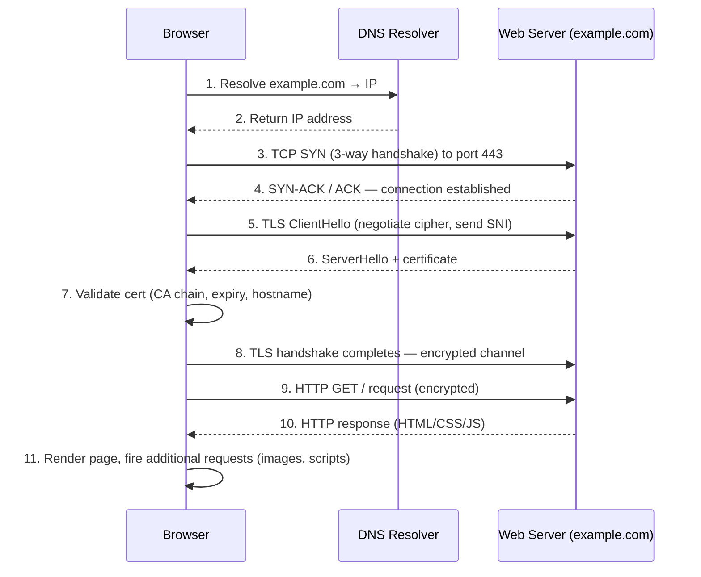
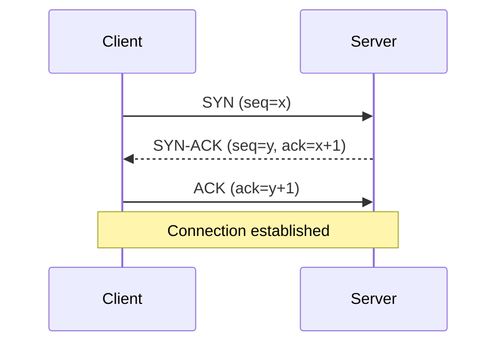
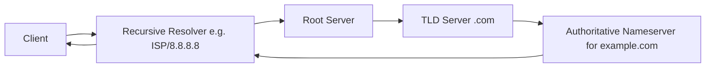

[← Back to index](README.md) | Tier 1 — Must master

# Phase 2 — Networking (Q21–60)

Networking fundamentals get asked first and fast — treat any hesitation here as a red flag for the interviewer, so know this section cold.

## 21. Explain the OSI model.
Seven layers describing how data moves from an application on one host to an application on another. Top-down when sending, bottom-up when receiving:

| Layer | Name | Examples | SOC relevance |
|---:|---|---|---|
| 7 | Application | HTTP, DNS, SMTP | Where phishing, web attacks, malware C2 payloads live |
| 6 | Presentation | TLS/SSL, encoding | Encryption/decryption, certificate issues |
| 5 | Session | Sessions, sockets | Session hijacking, token theft |
| 4 | Transport | TCP, UDP | Port scans, SYN floods, firewall rules |
| 3 | Network | IP, ICMP, routing | IP spoofing, routing attacks, NAT |
| 2 | Data Link | MAC, switches, ARP | ARP spoofing/poisoning, VLAN hopping |
| 1 | Physical | Cables, NICs, Wi-Fi | Physical tapping, rogue access points |

Mnemonic: "**A**ll **P**eople **S**eem **T**o **N**eed **D**ata **P**rocessing."

## 22. Explain the TCP/IP model.
The practical, 4-layer model the internet actually runs on — OSI is teaching theory, TCP/IP is what's implemented:

| TCP/IP Layer | Maps to OSI | Protocols |
|---|---|---|
| Application | 5–7 | HTTP, DNS, SMTP, FTP |
| Transport | 4 | TCP, UDP |
| Internet | 3 | IP, ICMP, ARP |
| Network Access (Link) | 1–2 | Ethernet, Wi-Fi |

## 23. TCP vs UDP?

| | TCP | UDP |
|---|---|---|
| Connection | Connection-oriented (handshake first) | Connectionless |
| Reliability | Guaranteed delivery, ordered, retransmits | Best-effort, no guarantee |
| Speed | Slower (overhead) | Faster (minimal overhead) |
| Use cases | HTTP/S, SSH, RDP, SMB, email | DNS, DHCP, syslog, streaming, VoIP |
| SOC relevance | Easier to track sessions (handshake = clear session boundary) | Easier to spoof source, favored for reflection/amplification DDoS and covert channels |

## 24. What happens when you enter https://example.com in a browser?
The single most common opener question — know this sequence cold, it touches DNS, TCP, TLS, and HTTP in one breath:

SOC angle: every one of these steps is a place attackers hide — DNS hijacking/spoofing at step 1, TLS interception or invalid certs at steps 6-7, and malicious payloads in the response at step 10.

## 25. Explain the TCP three-way handshake.

SYN → SYN-ACK → ACK. Establishes sequence numbers both directions and confirms both sides can send/receive before any data flows. A connection stuck at SYN (no SYN-ACK returned, or SYN-ACK sent but no final ACK) is a classic sign of a **SYN scan** or **SYN flood**.

## 26. What is a TCP SYN?
The first packet in the handshake — a request to open a connection. A flood of SYNs with no completed handshake (many half-open connections) is a SYN flood DoS attack; a SYN to many ports on one host in sequence is a port scan.

## 27. What is a TCP reset?
An **RST** packet that immediately and abruptly tears down a connection (no graceful FIN close). Seen when: a port is closed and refuses the connection, a firewall/IPS actively blocks a session, or an application crashes/rejects the request. In investigations, a burst of RSTs from an internal host to many external IPs/ports can indicate a fast scan or a blocked C2 beacon retrying.

## 28. What is DNS?
Domain Name System — translates human-readable hostnames (example.com) to IP addresses. Runs primarily over UDP/53 (falls back to TCP/53 for large responses like zone transfers).

## 29. Explain DNS resolution.

The client asks a recursive resolver, which (if not cached) walks the hierarchy: root → TLD (.com) → authoritative server for the domain, then caches and returns the answer. SOC relevance: this is why DNS logs show *who asked for what, when* — one of the richest and most complete visibility sources in an environment, since almost nothing communicates without a DNS lookup first (even hardcoded-IP malware is the exception, not the rule).

## 30. What is DNS tunneling?
Encoding data (commands, exfiltrated data) inside DNS queries/responses (e.g., in subdomain labels or TXT records) to move it in or out of a network — because DNS is almost always allowed outbound and rarely deeply inspected. Detected via: abnormally long/high-entropy subdomains, high query volume to a single unusual domain, unusual record types (TXT, NULL), and query volume mismatched with normal user behavior.

## 31. What is DHCP?
Dynamic Host Configuration Protocol — automatically assigns IP address, subnet mask, default gateway, and DNS servers to a device joining the network (UDP 67/68, "DORA": Discover, Offer, Request, Acknowledge). SOC relevance: DHCP logs let you map an IP-to-MAC-to-hostname at a point in time — essential for attributing an IP seen in a log back to a physical machine, especially on DHCP leases that rotate.

## 32. What is ARP?
Address Resolution Protocol — resolves a known IP address to its MAC address on the local network segment (broadcast "who has this IP?"). **ARP spoofing/poisoning** (sending forged ARP replies to redirect traffic through an attacker for MITM) is the main SOC-relevant abuse.

## 33. What is ICMP?
Internet Control Message Protocol — used for diagnostics and error reporting (ping = echo request/reply, traceroute, "destination unreachable"). No ports, no payload delivery by design. SOC relevance: attackers abuse it for host discovery/ping sweeps, and occasionally as a covert C2/exfil channel (ICMP tunneling) since it's often under-inspected.

## 34. What is NAT?
Network Address Translation — rewrites private IP addresses to a public IP (and back) as traffic crosses a boundary (e.g., router/firewall), so many internal hosts can share one public IP. SOC relevance: NAT means the source IP you see externally is the NAT device, not the real internal host — you need NAT/firewall logs to map back to the actual endpoint.

## 35. What is PAT?
Port Address Translation — NAT's most common form: many internal IPs share **one** public IP, distinguished by port number (each internal session gets a unique external port). This is why NAT/PAT logs (source IP + source port + timestamp) are required to identify which internal host made a given outbound connection.

## 36. Public IP vs private IP?
**Public** IPs are globally unique and routable on the internet. **Private** IPs (RFC1918) are only valid within a private network and are not routable on the internet — they reach the internet only via NAT.

## 37. What are RFC1918 private IP ranges?

| Range | CIDR |
|---|---|
| 10.0.0.0 – 10.255.255.255 | 10.0.0.0/8 |
| 172.16.0.0 – 172.31.255.255 | 172.16.0.0/12 |
| 192.168.0.0 – 192.168.255.255 | 192.168.0.0/16 |

Knowing these cold lets you instantly tell, while reading a log, whether traffic is internal-to-internal, internal-to-external, or (suspiciously) an internal-looking address appearing where it shouldn't.

## 38. What is a subnet?
A logically segmented portion of a network, defined by a range of IP addresses (via a subnet mask/CIDR). Subnetting isolates broadcast domains and — critically for security — lets you segment trust zones (e.g., user VLAN separate from server VLAN separate from DMZ).

## 39. What is CIDR?
Classless Inter-Domain Routing — notation for expressing an IP range as `address/prefix-length`, e.g. `192.168.1.0/24` = 256 addresses, first 24 bits fixed as network, last 8 bits are host addresses. Smaller number after the slash = larger range (`/8` is huge, `/30` is 4 addresses).

## 40. What is a default gateway?
The router a host sends traffic to when the destination is outside its own subnet — the "exit door" of the local network. If a host's default gateway is manually changed (or spoofed via a rogue DHCP/ARP attack), all its traffic can be silently redirected through an attacker.

## 41. What is a MAC address?
A 48-bit hardware address burned into a network interface card, used for Layer 2 (Data Link) addressing on the local segment. Format: `XX:XX:XX:XX:XX:XX` — the first 3 octets are the vendor OUI, useful for identifying device type during investigation.

## 42. IP address vs MAC address?

| | IP Address | MAC Address |
|---|---|---|
| Layer | Network (L3) | Data Link (L2) |
| Scope | Routable, can change networks | Local segment only, tied to hardware |
| Assigned by | DHCP/static config | Manufacturer (can be spoofed) |
| Persistence | Can change (DHCP lease) | Normally fixed per NIC |

## 43. What is a VLAN?
Virtual LAN — logically separates one physical switch into multiple isolated broadcast domains, tagged via 802.1Q. Used to segment trust zones (e.g., separate VLANs for user workstations, servers, guest Wi-Fi, IoT) so a compromise in one segment doesn't automatically have L2 access to another. **VLAN hopping** attacks exploit misconfigurations to jump segments.

## 44. What is a proxy?
An intermediary that relays traffic between a client and a destination on the client's behalf, so the destination sees the proxy, not the original client.

## 45. Forward proxy vs reverse proxy?

| | Forward Proxy | Reverse Proxy |
|---|---|---|
| Sits in front of | Clients (internal users) | Servers (backend services) |
| Hides | Client identity from the destination | Server identity/topology from the client |
| Typical use | Web filtering, egress logging, caching for a corporate network | Load balancing, TLS termination, WAF, protecting backend servers |
| SOC value | **Proxy logs show every outbound URL a user hit** — huge for phishing/malware investigation | Sits in the path of every inbound request — logs show attack attempts against web apps |

## 46. What is a VPN?
Virtual Private Network — creates an encrypted tunnel between two points (client-to-site or site-to-site) over an untrusted network, so traffic looks like it's on the private network even remotely. SOC relevance: VPN logs (connect time, source IP, user, duration) are essential for spotting **impossible travel**, off-hours access, or connections from unexpected countries/ASNs.

## 47. What is SSL/TLS?
Transport Layer Security (successor to the deprecated SSL) — provides encryption, integrity, and authentication for data in transit, most commonly wrapping HTTP to make HTTPS. Uses asymmetric crypto (certificates/public-private keys) to establish a session, then symmetric crypto for the bulk data (faster).

## 48. HTTP vs HTTPS?
HTTP transmits in plaintext — anyone on-path can read or modify it. HTTPS wraps HTTP in TLS, so contents are encrypted and can't be tampered with in transit, and the server's identity is verified via certificate.

## 49. HTTP vs HTTPS from a SOC investigation perspective?
With **HTTP**, full-packet capture / proxy logs show you the exact URL path, headers, and body — easy to inspect. With **HTTPS**, without TLS inspection (SSL decryption at a proxy/firewall) you typically only see the destination IP, the domain via **SNI** (Q51) in the ClientHello, and certificate metadata (JA3/JA3S fingerprints) — not the actual content or full URL path. This is exactly why SNI and certificate details matter so much for SOC visibility into encrypted traffic, and why many orgs deploy TLS-inspecting proxies for malware/DLP visibility.

## 50. What is a certificate?
A digitally signed document (X.509 standard) that binds a public key to an identity (a domain, organization), signed by a trusted Certificate Authority (CA), used to prove a server is who it claims to be during the TLS handshake. SOC relevance: self-signed certs, expired certs, certs issued minutes before use, or certs from free/anonymous CAs on a "legitimate-looking" domain are all phishing/C2 red flags.

## 51. What is SNI?
Server Name Indication — a field in the unencrypted TLS ClientHello that tells the server (or an on-path proxy) which hostname the client wants, so a single IP can serve multiple TLS certificates (virtual hosting) and — critically for SOC — **the destination domain of an HTTPS connection is visible even without decrypting the traffic**, because SNI is sent in cleartext before encryption begins.

## 52. What is a firewall?
A device/software that enforces network traffic policy — permits or denies traffic based on rules matching attributes like source/destination IP, port, protocol (and for next-gen firewalls, application and user identity).

## 53. Stateful vs stateless firewall?

| | Stateless | Stateful |
|---|---|---|
| Tracks | Each packet independently, no memory of prior packets | The full connection state (part of a handshake? established session?) |
| Rule complexity | Must explicitly allow both directions | Automatically allows return traffic for an established connection |
| Performance | Faster, simpler | More overhead, but far more secure |
| Modern usage | Rare/legacy, ACLs on some routers | Standard for virtually all modern firewalls |

## 54. What is an IDS?
Intrusion **Detection** System — passively monitors traffic (or a copy of it, via a SPAN/mirror port) and **alerts** on suspicious patterns. Does not sit inline and cannot block traffic itself.

## 55. What is an IPS?
Intrusion **Prevention** System — sits **inline** in the traffic path and can actively **block/drop** malicious traffic in real time, not just alert on it.

## 56. IDS vs IPS vs firewall?

| | Firewall | IDS | IPS |
|---|---|---|---|
| Decision basis | Rules: IP/port/protocol/app | Signatures/anomalies/behavior | Signatures/anomalies/behavior |
| Position | Inline | Out-of-band (mirrored traffic) | Inline |
| Action | Allow/deny by policy | Alert only | Alert **and** block |
| Catches | Traffic that shouldn't be allowed by policy | Known-bad patterns even on "allowed" traffic | Same as IDS, but can stop it live |

Layered together: firewall decides *what's allowed to talk to what*; IDS/IPS decides *whether allowed traffic is behaving maliciously*.

## 57. What is a WAF?
Web Application Firewall — inspects HTTP/S traffic specifically, filtering application-layer attacks a normal firewall can't see because it doesn't parse HTTP content: SQL injection, XSS, path traversal, malicious file uploads. Usually deployed as a reverse proxy in front of web apps.

## 58. Firewall vs WAF?
A network firewall operates at L3/L4 (IP/port) — it doesn't understand HTTP request bodies or parameters. A WAF operates at L7, understanding the actual web application traffic, so it can catch an SQLi payload in a form field that a normal firewall would just see as "allowed traffic to port 443."

## 59. What is a load balancer?
Distributes incoming traffic across multiple backend servers for availability and performance, and often also terminates TLS and performs basic health checks. SOC relevance: it also centralizes/normalizes logging for everything behind it, and can mask the true origin server from external scanning.

## 60. What is a DMZ?
Demilitarized Zone — a network segment sitting between the untrusted internet and the trusted internal network, hosting internet-facing services (web servers, mail relays) so that if one is compromised, the attacker still has to cross another security boundary to reach the internal network. Classic layout: Internet → firewall → DMZ → second firewall → internal LAN.

---
[← Back to index](README.md) · [← Phase 1](phase-01-soc-fundamentals.md) · [Next: Phase 3 — Ports & Protocols →](phase-03-ports-protocols.md)
