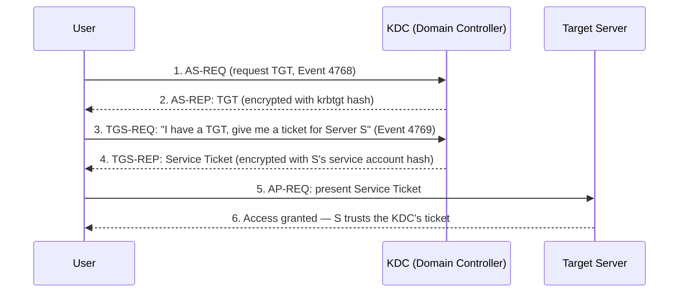

[← Back to index](README.md) | Tier 1 — Must master

# Phase 4 — Windows Security (Q85–120)

## 85. Explain Windows authentication.
When a user logs on, Windows verifies their identity via one of two protocols — **Kerberos** (default, modern, used whenever a domain controller is reachable) or **NTLM** (legacy fallback, hash-based challenge/response, used when Kerberos isn't available — e.g., IP-based access, workgroup, some legacy apps). Successful authentication produces an access token carrying the user's SID and group memberships, which Windows checks against resource ACLs for every subsequent access.

## 86. What is Active Directory?
Microsoft's directory service for Windows domain environments — a centralized database of users, groups, computers, and policies, plus the authentication (Kerberos) and authorization (group membership, GPOs) infrastructure built on top of it. It's the single highest-value target in almost every Windows-based attack, because compromising AD means compromising the trust anchor for the entire environment.

## 87. What is a domain controller?
A server that hosts the AD database (NTDS.dit) and handles authentication requests (Kerberos KDC role) and directory queries (LDAP) for the domain. Compromise of a DC is close to full domain compromise — it's always treated as a critical-severity incident.

## 88. What is Kerberos?
The default AD authentication protocol — ticket-based, relies on a trusted third party (the KDC, hosted on the domain controller) rather than sending passwords/hashes over the network for each access. Uses symmetric encryption keyed on secrets shared between each principal and the KDC.

## 89. Kerberos vs NTLM?

| | Kerberos | NTLM |
|---|---|---|
| Type | Ticket-based, mutual authentication | Challenge/response, hash-based |
| Requires | Domain controller reachable | No DC needed (workgroup-capable) |
| Credential exposure | Password/hash never sent over the wire | Hash effectively sent (challenge/response is crackable/relayable) |
| Common attacks | Kerberoasting, Golden/Silver Ticket, AS-REP Roasting | Pass-the-Hash, NTLM relay |
| SOC signal | Event IDs 4768/4769/4771 | Event ID 4624 with LogonType and AuthenticationPackageName = NTLM |

## 90. What is a Kerberos ticket?
An encrypted piece of data issued by the KDC that proves identity and authorizes access without re-sending credentials — the two types are the TGT and the service ticket (below).

## 91. What is a TGT?
Ticket Granting Ticket — issued by the KDC (Authentication Service) after initial logon, encrypted with the **krbtgt account's** password hash. It doesn't grant access to any specific resource — it's used only to request service tickets from the KDC without re-authenticating. A stolen/forged TGT (**Golden Ticket**, see phase 6) is one of the most dangerous AD compromises possible, since it's signed by krbtgt and trusted domain-wide.

## 92. What is a service ticket?
Issued by the KDC's Ticket Granting Service after presenting a valid TGT, encrypted with the **target service account's** password hash, and used to actually authenticate to that specific service. A stolen/forged service ticket for one service (**Silver Ticket**) only grants access to that one service, not the whole domain — a smaller blast radius than a Golden Ticket, but harder for the DC to see coming.

## 93. What is LDAP?
Lightweight Directory Access Protocol — the query protocol used to read/write objects in Active Directory (find users, groups, computers, OUs). Port 389 (plaintext) / 636 (LDAPS, encrypted). Heavy/unusual LDAP query volume from a single host is a classic **AD reconnaissance** signal (attacker enumerating users, groups, trusts, ACLs — often via tools like BloodHound).

## 94. What is SMB?
Server Message Block — Windows' file/printer sharing and inter-process communication protocol (port 445). Central to legitimate file access, and to some of the most damaging attack techniques: lateral movement (PsExec-style remote execution over SMB), credential relay (NTLM relay over SMB), and worm-like ransomware propagation (e.g., EternalBlue/WannaCry).

## 95. What is Windows Event Viewer?
The built-in GUI/log store for viewing Windows logs — Application, System, Security, and (with Sysmon installed) the Sysmon operational log. It's the local source; in a SOC you're almost always querying these logs centrally via a SIEM (forwarded via agent) rather than opening Event Viewer on the box itself.

## 96. What are Windows Security logs?
The specific Windows event log channel that records security-relevant events per the system's audit policy: logons/logoffs, object access, privilege use, account management, and policy changes. This is the primary source for the 46xx/47xx event IDs covered below.

## 97. What is Sysmon?
Microsoft Sysinternals' System Monitor — a free driver/service that logs far more detailed and security-relevant endpoint telemetry than default Windows auditing: full process command lines, parent-child relationships with hashes, network connections per process, file creation, registry modification, named pipes, and more, all with consistent Event IDs (e.g., Event ID 1 = process creation, 3 = network connection, 11 = file create, 22 = DNS query). It's effectively the difference between "an account logged on" and "here is exactly what that process tree did."

## 98. What does Sysmon provide that standard Windows logging may not?
- **Process hashes** (SHA256/MD5) on every process creation — standard logging doesn't hash.
- **Full parent-child process trees** with command lines, reliably (native 4688 needs command-line auditing enabled separately and is less rich).
- **Per-process network connections** — native Windows security logging doesn't log this at all.
- **File creation, registry changes, named pipe creation, driver loads, WMI activity** — none of which native auditing covers by default.
This is why Sysmon is close to mandatory in any environment doing real endpoint-based investigation, and why interviewers expect you to know it's a *separate install*, not built into Windows.

## 99. What is PowerShell logging?
Windows' built-in logging for PowerShell activity, primarily two feeds:
- **Module Logging** — logs the pipeline execution details of each command.
- **Script Block Logging** (Event ID **4104**) — logs the actual code executed, including de-obfuscated content, even for scripts that were obfuscated/encoded on the command line. This is the single most valuable log source for catching malicious PowerShell that hides itself with `-EncodedCommand` or string obfuscation.

## 100. What is command-line logging?
Enabling `ProcessCreationIncludeCmdLine_Enabled` so Event ID **4688** (process creation) includes the full command line the process was launched with, not just the executable name. Without this, 4688 tells you `powershell.exe` ran — with it, you can see it ran `powershell.exe -enc <base64>`, which is the difference between a useless alert and an actionable one.

## Important Event IDs (101–116)

| # | Event ID | Name | What it means |
|---:|---:|---|---|
| 101 | **4624** | Successful logon | An account successfully authenticated. Check the **Logon Type** (2=interactive, 3=network/SMB, 4=batch, 5=service, 10=RemoteInteractive/RDP, 11=cached) — the type tells you *how* they got in |
| 102 | **4625** | Failed logon | An authentication attempt failed. Volume + pattern (many accounts, one source; one account, many sources) distinguishes brute force from password spray |
| 103 | **4634** | Logoff | Session ended (may not always fire cleanly, e.g., on crash) |
| 104 | **4647** | User-initiated logoff | User explicitly logged off (vs. 4634's more general logoff) |
| 105 | **4672** | Special privileges assigned | Logon involved admin-equivalent rights — fires alongside 4624 for privileged accounts, useful for flagging every admin logon |
| 106 | **4688** | New process created | A process started — the workhorse event for endpoint investigation (pair with command-line logging) |
| 107 | **4697** | Service installed | A new service was installed on the host — common persistence mechanism |
| 108 | **4720** | User account created | New local/domain account created — check who created it and why |
| 109 | **4728** | Member added to a global security group | Group membership change — watch for additions to privileged groups |
| 110 | **4732** | Member added to a local security group | Same idea, local scope — e.g., added to local Administrators |
| 111 | **4740** | Account locked out | Usually a side effect of failed logon attempts — correlate with 4625 bursts |
| 112 | **4768** | Kerberos TGT requested (AS-REQ) | Initial authentication to the KDC — the first Kerberos event in any logon chain |
| 113 | **4769** | Kerberos service ticket requested (TGS-REQ) | Requesting access to a specific service — a burst of these for many different SPNs from one account/source is a **Kerberoasting** signal |
| 114 | **4771** | Kerberos pre-authentication failed | Kerberos-flavored failed logon — also relevant to **AS-REP Roasting** detection (requesting tickets for accounts with pre-auth disabled) |
| 115 | **1102** | Audit log cleared | Someone cleared the Security event log — a huge red flag, almost always investigated as anti-forensic/cover-tracks activity, near the top of any "if you see one thing, escalate" list |
| 116 | **7045** | New service installed (System log) | Same concept as 4697 but logged to the **System** log by the Service Control Manager — check both channels for service-based persistence |

## 117. Which event IDs would you investigate for account compromise?
**4625** (failed logons — spray/brute force pattern) → **4624** (the eventual success, check logon type and source) → **4768/4769/4771** (Kerberos-specific auth activity) → **4672** (did the compromised account have admin rights) → sign-in logs / impossible travel if cloud-integrated (Entra ID).

## 118. Which event IDs would you investigate for privilege escalation?
**4728/4732** (added to a privileged group) → **4720** (new account created, possibly for persistence with elevated rights) → **4672** (special privileges assigned at logon) → **4697/7045** (new service, often created running as SYSTEM to escalate).

## 119. Which event IDs would you investigate for lateral movement?
**4624** with Logon Type 3 (network) or 10 (RDP) from a source that isn't the user's normal workstation → **4648** (explicit credential logon — a hallmark of "runas"/PsExec-style movement, worth knowing even though it's not in the source list) → **4697/7045** (remote service creation — PsExec's signature) → **4769** (service ticket requests to multiple hosts in sequence).

## 120. Which event IDs would you investigate for persistence?
**4697/7045** (new service) → **4720** (new account) → **4728/4732** (group membership changes granting standing access) → scheduled task creation (Event ID 4698, worth knowing alongside these) → **1102** (log cleared right after — attacker covering the persistence mechanism they just planted).

---
[← Back to index](README.md) · [← Phase 3](phase-03-ports-protocols.md) · [Next: Phase 5 — Processes & Endpoint Security →](phase-05-processes-endpoint.md)
