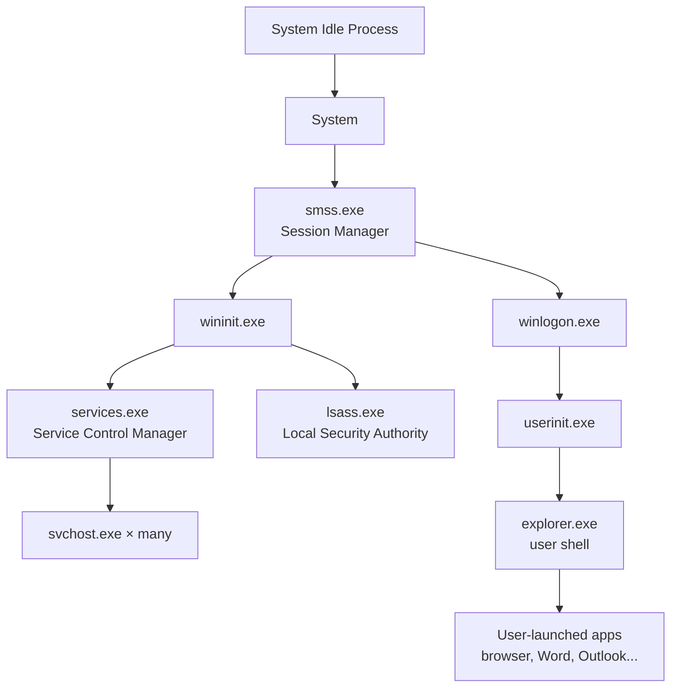

[← Back to index](README.md) | Tier 1 — Must master

# Phase 5 — Processes & Endpoint Security (Q121–150)

## 121. What is a process?
A running instance of a program — has its own memory space, at least one thread of execution, a unique PID, an owning user/token, and (except for the very first process) a parent process that spawned it.

## 122. What is a parent process?
The process that created (spawned) another process. Recorded in Sysmon Event ID 1 / EDR telemetry as `ParentImage` / `ParentProcessId`.

## 123. What is a child process?
A process spawned by another (its parent). The parent-child chain, followed all the way up, is called the **process tree** or **process lineage**.

## 124. Why is parent-child process relationship important in SOC investigations?
Because legitimate software has *predictable* parentage, and attacks routinely don't. `winword.exe` spawning `powershell.exe` is a process-tree anomaly the moment it happens — Word has no legitimate reason to launch a shell. Process lineage is often the **fastest signal** you have that something is wrong, faster than waiting for network/file-based detections, because the anomaly is structural, not signature-based, so it also catches attacks using tools nobody has written a signature for yet.

## The normal Windows process tree

Know this shape — anything that breaks it is a finding:

- `lsass.exe`'s parent should **always** be `wininit.exe`. Any other parent = near-certain LSASS masquerading/injection.
- `svchost.exe`'s parent should **always** be `services.exe`.
- User apps (browser, Office, Outlook) should live under `explorer.exe` — not under `services.exe` or another random process.

## 125–133. Core system & shell processes

| # | Process | What it is | SOC watch-for |
|---:|---|---|---|
| 125 | `explorer.exe` | The Windows shell/desktop UI, launched per logged-on user | Legitimate parent of most user-launched apps; malware sometimes injects here to blend in |
| 126 | `svchost.exe` | Generic host process for Windows services (DLL-hosted services grouped under shared instances) | Should always be a child of `services.exe`; multiple copies are normal — a `svchost.exe` with no `-k` service group argument or wrong parent is highly suspicious |
| 127 | `lsass.exe` | Local Security Authority Subsystem — handles authentication, holds credentials/hashes in memory | The #1 target for **credential dumping**; any unrecognized process opening a handle to it is critical |
| 128 | `winlogon.exe` | Handles secure logon (Ctrl+Alt+Del), session locking | Historically abused for GINA/Winlogon Notify persistence hooks |
| 129 | `services.exe` | Service Control Manager — starts/stops/manages all Windows services | Legitimate parent of `svchost.exe`; new service creation under it is normal, but the *service itself* may not be |
| 130 | `smss.exe` | Session Manager Subsystem — creates new sessions very early in boot | Should be short-lived and only near boot; a late-running or duplicate `smss.exe` is a red flag |
| 131 | `csrss.exe` | Client/Server Runtime Subsystem — core Win32 subsystem process | Critical system process, essentially never legitimately terminated or user-facing |
| 132 | `powershell.exe` | Windows PowerShell shell/scripting engine | Massively dual-use — legitimate admin tool and the single most common post-exploitation execution vector |
| 133 | `cmd.exe` | Command Prompt | Frequently the intermediate step in `Office app → cmd.exe → powershell.exe` malicious chains |

## 134–139. Living-off-the-land binaries (LOLBins)

| # | Process | Legitimate purpose | Abuse |
|---:|---|---|---|
| 134 | `rundll32.exe` | Runs functions exported from a DLL | Can execute arbitrary DLL code, common for malware execution/defense evasion |
| 135 | `regsvr32.exe` | Registers/unregisters DLLs (COM components) | "Squiblydoo" technique — can download and execute a scriptlet from a remote URL, bypassing application allow-listing |
| 136 | `mshta.exe` | Runs Microsoft HTML Application (`.hta`) files | Executes JScript/VBScript with full trust outside the browser sandbox — classic phishing payload execution |
| 137 | `wscript.exe` | Runs Windows Script Host scripts (GUI) | Executes `.vbs`/`.js` attachments — common phishing dropper |
| 138 | `cscript.exe` | Runs Windows Script Host scripts (console) | Same as wscript, console version |
| 139 | `certutil.exe` | Certificate services utility | Its base64 encode/decode functions get abused to download files (`certutil -urlcache -f`) or decode a staged payload while evading file-download-specific detections |

## 140. What is a LOLBin?
"Living-off-the-land binary" — a **legitimate, signed, pre-installed** Windows binary that has some functionality attackers can repurpose to download, execute, or hide malicious activity, letting them avoid dropping their own (detectable) tools. Because the binary itself is trusted and signed by Microsoft, allow-listing alone won't stop it — you have to look at *how* it's being invoked (arguments, parent process, network activity).

## 141. Give examples of LOLBins.
`rundll32.exe`, `regsvr32.exe`, `mshta.exe`, `certutil.exe`, `wscript.exe`/`cscript.exe`, `powershell.exe`, `bitsadmin.exe` (background download), `msbuild.exe` (compiles and runs inline code), `installutil.exe`, `wmic.exe`. [LOLBAS project](https://lolbas-project.github.io/) is the canonical reference — worth mentioning by name in an interview.

## 142. How can attackers abuse PowerShell?
- **Fileless execution** — download and run a payload entirely in memory (`IEX (New-Object Net.WebClient).DownloadString(...)`), never touching disk.
- **Obfuscation** — `-EncodedCommand` (base64), string concatenation/reversal to dodge signature detection.
- **Credential access** — modules like Mimikatz can be loaded reflectively in-memory.
- **Discovery/lateral movement** — enumerate AD (`Get-ADUser`, etc.), use PowerShell remoting (WinRM) to execute on remote hosts.
- **Downgrade attacks** — invoking PowerShell v2 to dodge AMSI/Script Block Logging, which weren't present in that version.

## 143. How would you determine whether PowerShell execution is malicious?
1. Pull the **full command line / decoded script block** (Event ID 4104) — never judge from the process name alone.
2. Check the **parent process** — Office app, browser, or `mshta`/`wscript` spawning PowerShell is highly suspect; a help-desk admin running it from `explorer.exe` interactively is normal.
3. Look for **obfuscation markers** — `-enc`/`-EncodedCommand`, `-nop`, `-w hidden`, `-ExecutionPolicy Bypass`, excessive string concatenation.
4. Check for **suspicious cmdlets** — `DownloadString`, `Invoke-Expression`, `Invoke-Mimikatz`, `Invoke-WebRequest` to an unfamiliar domain.
5. Check **network activity** that followed — did it reach out anywhere, and to what kind of destination (reputation, first-seen)?
6. Check **AMSI/Defender alerts** tied to the same session.
7. Check whether the **user/host normally runs PowerShell** at all (baseline) — PowerShell from a receptionist's laptop reads very differently than from a sysadmin's.

## 144. What makes a process suspicious?
- Running from an unusual location (`%TEMP%`, `%APPDATA%`, `C:\Users\Public`, a recycle bin folder) instead of `Program Files`/`System32`.
- Unsigned, or signed with an unrecognized/mismatched certificate.
- Masquerading — a filename mimicking a system process (`scvhost.exe`, `lsass .exe` with a trailing space) but running from the wrong path.
- Abnormal parent-child relationship (Office → shell, browser → shell).
- Command-line arguments indicating obfuscation, encoded payloads, or download cradles.
- Unusual network behavior — beaconing, connections to rare/newly-registered domains, non-standard ports.
- High-entropy or randomly-named files being written to disk by the process.

## 145. How do you investigate a suspicious executable?
1. **Static triage** — file hash (MD5/SHA256), check against VirusTotal/internal threat intel, file signing status/certificate, file path, creation/modification timestamps.
2. **Provenance** — where did it come from (download, email attachment, removable media, dropped by another process)?
3. **Execution context** — who ran it, on what host, what was the parent process and full command line?
4. **Behavior** — child processes spawned, files written/modified, registry changes, network connections (via EDR telemetry).
5. **Scope** — does the same hash/filename/behavior appear on any other host in the environment?
6. **Sandbox/dynamic analysis** — if available, detonate in an isolated sandbox to observe behavior safely rather than guessing from static data alone.
7. **Decision** — classify (benign/PUP/malicious), and if malicious, move to containment (isolate host, block hash/IOC globally) and scoping the rest of the environment.

## 146. What information do you collect from an endpoint?
Running processes and full process tree, loaded modules/DLLs, network connections, logged-on users/sessions, autoruns/persistence locations (Run keys, scheduled tasks, services), recently created/modified files, browser history if relevant, EDR/Sysmon event history for the host, patch/AV status, and a memory capture if forensic-grade evidence is needed.

## 147. What is process injection?
A technique where malicious code is inserted into and executed within the memory space of a **legitimate, already-running process**, so the malicious activity appears to come from a trusted process (evading detections that trust-list by process name) and can survive even if the original dropper file is deleted. Broad technique category under MITRE ATT&CK T1055.

## 148. What is DLL injection?
A specific process injection method: forcing a target process to load and execute a malicious DLL (e.g., via `CreateRemoteThread` + `LoadLibrary`, or `SetWindowsHookEx`), so the malicious code runs inside that process's context and address space.

## 149. What is credential dumping?
Extracting authentication credentials (plaintext passwords, password hashes, Kerberos tickets) from a compromised system's memory, registry, or disk (e.g., LSASS memory, SAM database, NTDS.dit, cached domain credentials) so an attacker can reuse them for further access — MITRE ATT&CK **Credential Access** tactic, technique T1003.

## 150. What is LSASS dumping?
The specific and most common form of credential dumping: reading the memory of `lsass.exe`, which holds active session credentials/hashes, and saving it (a "minidump") for offline extraction — classically via tools like Mimikatz, or via legitimate-looking abuse of `procdump.exe`, `comsvcs.dll`'s `MiniDump` export via `rundll32`, or Task Manager's "Create dump file." Detected via EDR alerting on any process opening a handle to `lsass.exe` with memory-read access outside of a small allow-list (Windows Defender, other legitimate security tooling).

---
[← Back to index](README.md) · [← Phase 4](phase-04-windows-security.md) · [Next: Phase 6 — Active Directory Attacks →](phase-06-ad-attacks.md)
