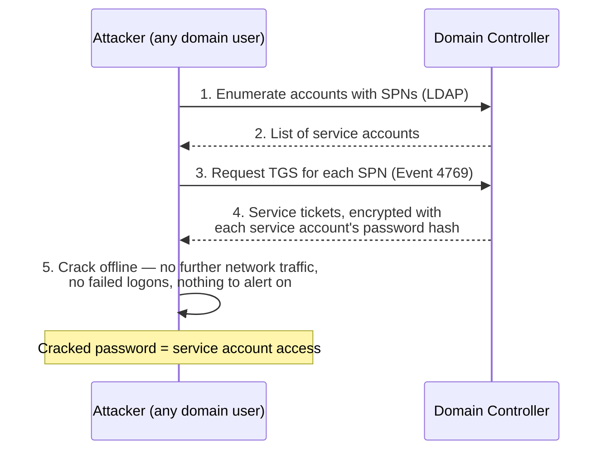
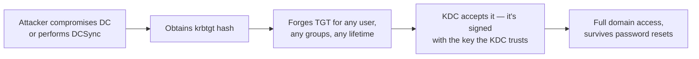

[← Back to index](README.md) | Tier 1 — Must master

# Phase 6 — Active Directory Attacks (Q151–170)

Expect these as scenario questions: *"how would you detect Kerberoasting?"* rather than *"define Kerberoasting."* Each answer below carries the detection signal, because that's what gets asked next.

## 151. What is password spraying?
Trying **one (or a few) common passwords against many accounts**, staying under the lockout threshold per account. Because each account only sees 1-2 failures, per-account lockout policies never trigger — which is exactly why it evades the controls brute force runs into.
**Detection:** many 4625s across *many distinct accounts* from a *single source IP* in a short window; low failure count per account. In Entra, the same pattern in `SigninLogs` with error code 50126.

## 152. Brute force vs password spraying?

| | Brute force | Password spraying |
|---|---|---|
| Shape | Many passwords → **one** account | One password → **many** accounts |
| Lockout risk | High — triggers lockout fast | Low — deliberately stays under threshold |
| Detection signal | High 4625 count on a single account (+ 4740 lockout) | Low 4625 count across many accounts, same source |
| Pivot to detect | Group by target account | **Group by source IP, count distinct accounts** |

The grouping difference is the interview point — you detect them with different queries.

## 153. What is credential stuffing?
Using **username/password pairs stolen from a breach elsewhere** against your organization, betting on password reuse. Distinguished from spraying because the passwords aren't guessed — they're known-valid somewhere else, so success rates are higher and failure volume can be low.
**Detection:** successful logins from unusual IPs/ASNs with no preceding failure pattern, matches against breached-credential intel, and a burst of attempts across accounts whose credentials appear in a known dump.

## 154. What is Kerberoasting?
An attacker (any authenticated domain user — no special privileges needed) requests **service tickets (TGS) for accounts that have an SPN registered**. The ticket is encrypted with the service account's password hash, so the attacker takes it offline and cracks it at leisure. Service accounts often have weak, old, never-rotated passwords and high privilege — which is what makes this so effective.

**Detection:** a burst of **Event 4769** requests for many distinct SPNs from one account/host in a short window, especially with **encryption type 0x17 (RC4)** — attackers request RC4 because it's far easier to crack than AES.

## 155. What is AS-REP Roasting?
Targets accounts with **"Do not require Kerberos pre-authentication"** enabled. Because pre-auth is off, the attacker can request an AS-REP for that account **without knowing its password**, and the response contains material encrypted with the account's password hash — crackable offline. Even less noisy than Kerberoasting since it needs no valid domain credentials at all.
**Detection:** **Event 4768** requests for accounts with pre-auth disabled, especially with RC4 encryption; also audit AD for any account with `DONT_REQ_PREAUTH` set (there should be almost none).

## 156. What is Pass-the-Hash?
Reusing a stolen **NTLM password hash** to authenticate directly, without ever cracking it to plaintext — because NTLM's challenge/response only needs the hash. Requires the hash to be dumped first (LSASS, SAM).
**Detection:** 4624 Logon Type 3 with NTLM authentication where Kerberos would be expected, the same account authenticating from an unusual host, and preceding LSASS-access/credential-dumping activity on the source machine.

## 157. What is Pass-the-Ticket?
Stealing a **Kerberos ticket** (TGT or service ticket) from a compromised machine's memory and injecting it into another session to impersonate that user — no password or hash needed, just the ticket while it's valid.
**Detection:** tickets used from a different host than the one they were issued to, anomalous ticket lifetimes, and 4768/4769 patterns inconsistent with the account's normal logon behavior.

## 158. What is a Golden Ticket?
Forging a **TGT** using the compromised **krbtgt account hash**. Because every TGT in the domain is encrypted with krbtgt's key, an attacker holding that hash can mint a valid TGT for **any user, with any group membership, for any lifetime** — effectively unlimited, self-service domain access that the KDC will honor without checking whether the account exists or is disabled.

**Critical detail interviewers probe:** resetting the compromised user's password does **not** help — you must reset the **krbtgt account password twice** (twice, because AD keeps the previous key for backward compatibility, so a single reset leaves the old key still valid).
**Detection:** TGTs with anomalous lifetimes (10-year tickets), 4769 requests with no corresponding 4768 (a ticket that was never legitimately issued), tickets for non-existent or disabled accounts, and RC4 encryption where AES is standard.

## 159. What is a Silver Ticket?
Forging a **service ticket** using a compromised **service account's** hash. Grants access only to that one service on that one host — a smaller blast radius than a Golden Ticket, but **stealthier**, because the ticket is presented directly to the target service and **never touches the domain controller**, so there's no 4768/4769 on the DC to detect.
**Detection:** rely on the *target host's* logs — 4624 logons with no corresponding DC-side Kerberos ticket request is the tell-tale mismatch.

## 160. What is DCSync?
Abusing the **directory replication** privileges (`DS-Replication-Get-Changes` / `-All`) to ask a domain controller to replicate password hashes — including **krbtgt** — while pretending to be another DC. The attacker never needs to touch the DC's disk or run code on it; they just make a legitimate-looking replication request from a normal workstation.
**Detection:** **Event 4662** showing replication-related GUIDs requested by an account that is not a domain controller — this is the single highest-fidelity DCSync indicator. Any non-DC source performing replication is malicious by definition.

## 161. What is LDAP reconnaissance?
Querying AD via LDAP to map the environment — users, groups, computers, trusts, ACLs, SPNs, admin relationships. Tools like BloodHound/SharpHound do this at scale to compute attack paths to Domain Admin. Usually one of the first things an attacker does after gaining any foothold.
**Detection:** high volume of LDAP queries from a single non-admin workstation, queries enumerating all users/groups/SPNs, unusual query patterns (Event 1644 with verbose LDAP logging enabled), and BloodHound-characteristic query sequences.

## 162. What is SMB lateral movement?
Using SMB (port 445) with stolen credentials to access remote systems — writing a payload to the ADMIN$/C$ share and executing it remotely (the PsExec pattern), or accessing/exfiltrating data from file shares.
**Detection:** 4624 Logon Type 3 to many hosts from one source, **7045/4697 service creation** on the targets, file writes to admin shares, and one account touching an unusual number of machines in a short window.

## 163. What is RDP lateral movement?
Using stolen credentials over RDP (3389) to interactively access other machines, often chaining hop-to-hop (workstation → server → DC).
**Detection:** 4624 **Logon Type 10** from unusual sources, workstation-to-workstation RDP (rare legitimately), RDP from hosts that aren't admin jump boxes, and chains where a host that just received an RDP session immediately initiates one outbound.

## 164. What is PsExec?
A legitimate Sysinternals tool for executing commands on remote Windows systems. It works by writing a service binary to the target's ADMIN$ share over SMB, creating and starting a service to run it, then cleaning up. Heavily abused for lateral movement because it's signed, legitimate, and often already present.
**Detection signature:** service creation events (**7045/4697**) with randomly-named services or `PSEXESVC`, SMB writes to ADMIN$, and named pipe creation (`\\pipe\\psexesvc`).

## 165. What is Windows Remote Management?
WinRM — Microsoft's remote management protocol (ports **5985** HTTP / **5986** HTTPS), the transport behind PowerShell Remoting (`Enter-PSSession`, `Invoke-Command`). Legitimate admin tooling; also a favored lateral movement channel because it's built-in, often allowed by firewall policy, and generates less obvious telemetry than PsExec.
**Detection:** WinRM connections between hosts that don't normally manage each other, `wsmprovhost.exe` spawning unexpected child processes (that's the giveaway — it's the process WinRM runs remote commands under), and PowerShell script block logs on the target.

## 166. What is privilege escalation?
Gaining higher permissions than initially obtained. **Vertical** — user → admin → SYSTEM/Domain Admin (via exploits, misconfigurations, token theft, credential access). **Horizontal** — moving to another account at the same level with different access. In AD specifically: abusing over-permissive ACLs, unconstrained delegation, GPO write rights, or service account misconfigurations.
**Detection:** 4672 (special privileges), 4728/4732 (privileged group additions), 4720 (new accounts), 4697/7045 (services running as SYSTEM), and token manipulation alerts from EDR.

## 167. What is lateral movement?
Moving from the initially compromised host to other systems in the environment, typically using stolen credentials, to reach the actual objective (data, domain control). It's the phase where an incident goes from "one machine" to "the environment," which is why detecting it early is so valuable.

## 168. How would you detect lateral movement?
Layer several signals — no single one is reliable:
1. **Authentication anomalies** — one account authenticating to an unusual number of hosts, or to hosts it has never touched (4624 types 3 and 10).
2. **Explicit credential use** — Event **4648** (logon with explicitly supplied credentials), a strong runas/PsExec indicator.
3. **Remote execution artifacts** — service creation (7045/4697), scheduled task creation (4698), WMI process creation, `wsmprovhost.exe` children.
4. **Network patterns** — internal SMB/RDP/WinRM connections between hosts that have no business relationship, especially workstation-to-workstation.
5. **Timing** — machine-speed sequences (many hosts in minutes) rather than human-paced activity.
6. **Correlation** — credential dumping on host A immediately followed by that credential appearing on host B.

## 169. How would you detect compromised domain administrator credentials?
- DA account logging on **interactively to workstations or non-DC servers** — DAs should only log on to DCs/PAWs; anything else is either a policy violation or a compromise, and both need attention.
- DA authentication from unusual source hosts, at unusual hours, or from unusual geographies.
- **DCSync activity** (4662 replication from a non-DC).
- Sudden privileged group changes, new account creation, or GPO modifications performed by the DA account.
- DA credentials appearing on a host where credential dumping was detected.
- Concurrent sessions for the same DA account from multiple hosts.
- Baseline deviation generally — DA accounts have small, highly predictable usage patterns, which makes anomaly detection unusually effective for them.

## 170. How would you investigate suspicious authentication across multiple hosts?
1. **Build the authentication timeline** for the account — every 4624/4625 across all hosts, ordered, with logon types and source IPs.
2. **Map the pattern** — is it one source fanning out to many targets (lateral movement), many sources to one target (collection point/spraying), or sequential hops (chained movement)?
3. **Check logon types** — type 3 (network/SMB), 10 (RDP), and 4648 (explicit credentials) each imply a different technique.
4. **Check the pace** — human or automated?
5. **Check what happened on each target** post-authentication — process creation, service installation, file access.
6. **Find the origin** — the first host in the chain, and how the credential was obtained there (credential dumping? phishing? spray?).
7. **Check privilege** — what does this account have access to, and did the attacker try to escalate?
8. **Scope and contain** — disable/reset the credential (coordinating if it's a service account), isolate the origin host, and expand the search until no new hosts appear.

---
[← Back to index](README.md) · [← Phase 5](phase-05-processes-endpoint.md) · [Next: Phase 7 — Identity & Entra ID →](phase-07-identity-entra-id.md)
