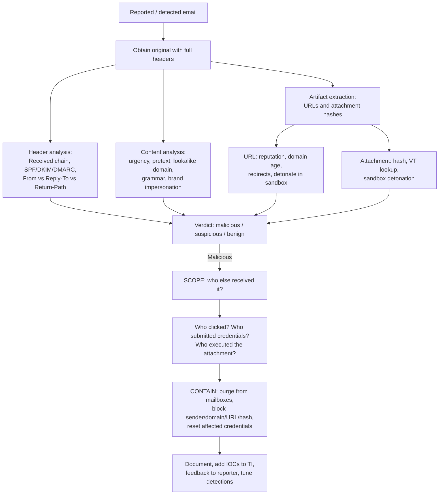

[← Back to index](README.md) | Tier 1 — Must master

# Phase 8 — Email & Phishing (Q195–217)

Phishing is the highest-volume investigation type in almost every SOC — expect the scenario questions (209-217) to be asked in depth.

## 195. What is phishing?
A social engineering attack delivered (usually) by email, impersonating a trusted sender to trick the recipient into revealing credentials, opening a malicious attachment, clicking a malicious link, or performing an action (like a wire transfer). Still the #1 initial access vector in real-world breaches.

## 196. Spear phishing vs phishing?
**Phishing** is broad and untargeted — the same message to thousands, low effort, low per-target success rate. **Spear phishing** is targeted at a specific individual or small group, using researched personal details (their role, colleagues, current projects, recent events) to be far more convincing. Spear phishing is harder to detect precisely because it doesn't look like bulk mail and often has no reused indicators.

## 197. What is whaling?
Spear phishing aimed at **senior executives or other high-value targets** (C-suite, finance directors, senior officials). Higher payoff because of their authority and access, and often paired with BEC.

## 198. What is Business Email Compromise?
BEC — an attacker either compromises or convincingly impersonates a legitimate business email account (often an executive, finance staff, or a supplier) to induce fraudulent payments, redirect invoices, or extract sensitive data. **Frequently involves no malware and no malicious links at all** — which is exactly why it evades traditional email security and has to be caught through behavioral and financial-process controls. One of the costliest attack categories by financial loss.

## 199. What is credential phishing?
Phishing whose goal is harvesting usernames and passwords — typically a link to a convincing fake login page (Microsoft 365, VPN portal, bank). Modern versions use **adversary-in-the-middle** proxies (Evilginx-style) that relay the real login in real time, capturing not just the password but the **session token after MFA is completed** — meaning MFA alone does not stop them.

## 200. What is a malicious attachment?
A file attached to an email designed to execute code or harvest credentials — macro-enabled Office documents, PDFs with embedded links/scripts, archives (ZIP/ISO/IMG, popular because they bypass Mark-of-the-Web protections), LNK shortcut files, HTML smuggling attachments, and script files (.js, .vbs, .hta).

## 201. What is a malicious URL?
A link leading to a credential harvesting page, an exploit kit, or a malware download. Common evasions: URL shorteners, open redirects on legitimate domains, homoglyph/typosquatted domains, QR codes ("quishing") that move the link off the scanned email entirely, and legitimate file-sharing/cloud services hosting the payload.

## 202. What is URL reputation?
A scoring of whether a URL is known-malicious, based on threat intel feeds, sandbox detonation results, domain age, hosting infrastructure, and historical behavior. Caveat worth stating: **unknown ≠ safe.** Targeted attacks use freshly registered domains with no reputation history precisely to evade reputation-based blocking.

## 203. What is domain reputation?
The same concept at domain level — factoring registration date, registrar, hosting ASN, SSL certificate details, historical malicious activity, and whether it's a lookalike of a known brand. **Newly registered domains (< 30 days) are a strong standalone risk signal** and many organizations block or flag them wholesale.

## 204. What is email spoofing?
Forging the sender address so a message appears to come from someone it doesn't. Possible because SMTP has no built-in sender authentication — which is exactly the gap SPF, DKIM, and DMARC exist to close. Note the distinction interviewers probe: the **envelope sender** (`MAIL FROM`, what SPF checks) and the **header From** (what the user sees) are different fields, and an attacker can pass SPF on a domain they control while displaying a spoofed header From.

## 205. What is SPF?
Sender Policy Framework — a DNS TXT record listing which mail servers are authorized to send mail for a domain. The receiving server checks whether the sending IP is on that list. **Limitation:** it validates the *envelope* sender, not the visible `From:` header, and it breaks on forwarding (the forwarder's IP isn't on the original domain's list).

## 206. What is DKIM?
DomainKeys Identified Mail — the sending server cryptographically **signs** the message (headers and body) with a private key; the receiver verifies it using the public key in the sender's DNS. Proves the message genuinely came from that domain and **wasn't altered in transit**. Survives forwarding better than SPF.

## 207. What is DMARC?
Domain-based Message Authentication, Reporting and Conformance — sits on top of SPF and DKIM and adds two things they lack: **alignment** (the domain in the visible `From:` header must match the SPF/DKIM-validated domain — this is what actually stops header-From spoofing) and a **published policy** telling receivers what to do on failure: `p=none` (monitor only), `p=quarantine` (junk it), `p=reject` (refuse it). Plus aggregate reporting back to the domain owner.

## 208. SPF vs DKIM vs DMARC?

| | SPF | DKIM | DMARC |
|---|---|---|---|
| Validates | Sending **IP** is authorized | Message **signature** and integrity | **Alignment** of SPF/DKIM with the visible From + policy |
| Checks which field | Envelope sender (`MAIL FROM`) | DKIM signature domain (`d=`) | Header `From:` — what the user actually sees |
| Breaks on forwarding | Yes | Usually no | Depends on which underlying check passes |
| Tells receiver what to do | No | No | **Yes** — none/quarantine/reject |

The one-liner to give in an interview: *"SPF says who may send, DKIM proves the message wasn't tampered with and really came from that domain, and DMARC ties them to the address the user actually sees and tells the receiver what to do when it doesn't match. You need all three — SPF and DKIM alone don't stop header-From spoofing."*

## 209. What email headers would you investigate?

| Header | What it tells you |
|---|---|
| `Received` (the full chain) | The actual path the message took — **read bottom-up**, the lowest entry is the origin. Reveals the true sending IP regardless of what the From says |
| `From` | The displayed sender — trivially spoofable, never trust alone |
| `Return-Path` / envelope sender | Where bounces go — a mismatch with `From` is a spoofing signal |
| `Reply-To` | Where a reply actually goes — a mismatch with `From` is a classic BEC/phishing tell |
| `Authentication-Results` | The receiving server's SPF, DKIM, and DMARC verdicts — your fastest legitimacy check |
| `Message-ID` | Unique identifier; malformed or inconsistent-with-sending-domain IDs are suspicious, and it's the key for tracking the message across mailboxes |
| `X-Originating-IP` | Original sender IP where present |
| `X-Mailer` / `User-Agent` | Sending client — bulk mailer tools stand out |
| `Subject`, `Date` | Correlation and campaign scoping; a Date inconsistent with the Received chain is a signal |

## 210. How do you investigate a phishing email?


Never open links or attachments on your own workstation — use a sandbox or an isolated analysis VM, and defang indicators (`hxxp://bad[.]com`) when writing them into tickets so nobody clicks them by accident.

## 211. How do you determine how many users received the email?
Search the mail security platform / message trace by the campaign's distinguishing attributes — **sender address, sender IP/domain, subject line, Message-ID pattern, attachment hash, or embedded URL**. In Microsoft 365 that's Threat Explorer / message trace, or KQL against `EmailEvents`:

```kql
EmailEvents
| where Timestamp > ago(7d)
| where SenderFromAddress == "attacker@malicious.com"
    or Subject == "Urgent: Verify Your Account"
| summarize Recipients = make_set(RecipientEmailAddress), Count = count() by Subject, SenderFromAddress
```

Search on *multiple* attributes, not just sender — attackers rotate sender addresses within a single campaign, so subject/URL/hash often scope it more completely.

## 212. How do you determine who clicked the link?
- **Email security URL-rewrite/click-tracking logs** (Safe Links in Microsoft 365 — `UrlClickEvents`) — the most direct answer, since the click is recorded explicitly.
- **Proxy/web gateway logs** — search for the destination URL/domain and see which internal users requested it.
- **DNS logs** — which hosts resolved the phishing domain (catches clicks even if the connection was blocked afterwards).
- **Firewall logs** — connections to the destination IP.
- **EDR network telemetry** — per-process connections, which also tells you *which browser/process* made the request.

```kql
UrlClickEvents
| where Timestamp > ago(7d)
| where Url contains "malicious-domain.com"
| project Timestamp, AccountUpn, Url, ActionType, IsClickedThrough
```

Note `IsClickedThrough` — it distinguishes users who were blocked and stopped from those who clicked past the warning page.

## 213. How do you determine who submitted credentials?
This is the hardest one, and the honest answer earns credit: **you often cannot prove it directly from logs**, because the credential submission happens on the attacker's server, not yours.
1. **Ask the user directly** — for those who clicked, contact them; often the fastest reliable answer.
2. **Look for POST activity** in proxy logs to the phishing URL (a POST rather than just a GET suggests form submission — though TLS may limit visibility to just the domain).
3. **Look for the consequence instead of the act** — subsequent anomalous sign-ins on those users' accounts: unfamiliar IPs, impossible travel, new MFA registrations, new inbox rules. Evidence of attacker use is proof of successful harvest.
4. **Check session duration / page interaction** where the tooling records it.
5. **Default to assuming compromise for anyone who clicked through** — reset their credentials rather than waiting for proof. Say this in the interview: *"the cost of an unnecessary password reset is minutes; the cost of missing a real credential theft is an incident."*

## 214. What logs would you check if you don't have EDR?
- **Email gateway / message trace** — delivery, recipients, verdicts, and purge status.
- **Proxy / web gateway** — URLs requested, allowed vs. blocked, per-user.
- **DNS** — domain resolution per host (nearly everything starts here).
- **Firewall** — connections to the phishing/C2 infrastructure and whether they succeeded.
- **Windows Event Logs** — 4688 process creation for attachment execution, 4624/4625 for subsequent auth anomalies.
- **Entra ID sign-in and audit logs** — attacker use of harvested credentials, inbox rule creation, app consents.
- **Mailbox audit logs** — rule creation, mass access, forwarding.
- Plus direct host triage on any specific machine of concern (prefetch, autoruns, scheduled tasks, running processes).

## 215. What containment actions would you take after credential phishing?
1. **Reset passwords** for all confirmed/suspected credential submitters.
2. **Revoke all sessions and refresh tokens** — a reset alone leaves a stolen token valid ([phase-07 Q189](phase-07-identity-entra-id.md#189-what-is-token-theft)). This is the single most commonly missed step and interviewers watch for it.
3. **Purge the email** from all mailboxes (soft-delete/hard-delete via the mail security platform).
4. **Block the indicators** — sender address and domain, phishing URL and domain, attachment hash — at the mail gateway, proxy, firewall, and DNS.
5. **Check and remove attacker persistence** on affected accounts — inbox rules, forwarding, new MFA methods, OAuth consents, delegate permissions.
6. **Review sign-in logs** for those accounts for any successful attacker authentication, and investigate anything found as a full account compromise.
7. **Notify affected users and their managers**; brief the wider organization if the campaign is broad.
8. **Add IOCs to threat intelligence** and create/tune a detection so a repeat of this campaign is caught automatically.

## 216. How would you investigate a malicious attachment?
1. **Extract safely** — never open on a production machine; work in an isolated VM or sandbox.
2. **Hash it** (SHA256) and check reputation (VirusTotal, internal TI). Unknown hash ≠ safe.
3. **Identify the true file type** — check magic bytes, not the extension (a `.pdf` that's really an `.exe` or `.lnk`).
4. **Static analysis** — for Office files: does it contain macros/VBA, and what does the code do? Look for auto-execute triggers (`AutoOpen`, `Document_Open`), obfuscated strings, shell/WMI calls, embedded URLs. For PDFs: embedded JavaScript, launch actions, embedded files. For archives: what's inside, and does it use Mark-of-the-Web bypass (ISO/IMG)?
5. **Dynamic analysis** — detonate in a sandbox and observe: process tree spawned, files written, registry changes, network callouts, persistence created.
6. **Extract IOCs** — C2 domains/IPs, dropped file hashes, mutexes, persistence paths.
7. **Determine execution in your environment** — did any recipient actually open/execute it? Check EDR process events and 4688 for the parent Office app spawning children.
8. **Scope and contain** — hunt the hash and any C2 indicator estate-wide, isolate affected hosts, block all extracted IOCs.

## 217. How would you investigate a Business Email Compromise?
BEC has no malware to hunt, so the investigation is entirely about **identity and mail behavior**:
1. **Determine which side it is** — is our account genuinely compromised, or is an external party impersonating (lookalike domain, display-name spoofing)? Check the headers and authentication results first; this changes the whole response.
2. **If our account is compromised**: pull sign-in logs — unfamiliar IPs/ASNs, impossible travel, legacy authentication use, MFA status.
3. **Check mailbox audit logs for attacker tradecraft**:
   - **Inbox rules** that auto-forward, auto-delete, or move messages containing words like "invoice," "payment," "wire," or "security" to obscure folders — the hallmark of BEC, used to hide the conversation from the real user.
   - **External forwarding** configured on the mailbox.
   - **Delegate/mailbox permissions** granted.
   - **Sent items** the user doesn't recognize — and check the Deleted Items/Recoverable Items, since attackers delete their sent messages.
4. **Reconstruct the fraudulent conversation** — who was contacted, what was requested, what bank details were supplied.
5. **Determine financial exposure immediately** — was a payment made or initiated? **If yes, engage finance and the bank urgently** — same-day recall is sometimes possible and every hour matters. Say this: recognizing the financial-response urgency, not just the technical one, is what distinguishes a BEC answer.
6. **Check scope** — did the attacker email other internal staff or external partners from the account (BEC frequently propagates to suppliers and customers)?
7. **Contain** — reset password, revoke sessions, remove rules/forwarding/delegates, and block the attacker's infrastructure.
8. **Notify** — affected internal staff, the counterparties who received fraudulent mail, finance, legal/compliance, and management. External notification matters here because partners may be actively being defrauded.
9. **Harden** — MFA everywhere, block legacy authentication, alert on inbox rule creation, and (process-side) require out-of-band verification for payment/bank-detail changes. That last control stops BEC better than any technical measure.

---
[← Back to index](README.md) · [← Phase 7](phase-07-identity-entra-id.md) · [Next: Phase 9 — Malware →](phase-09-malware.md)
