[← Back to index](README.md) | Tier 2 — Strong knowledge

# Phase 10 — MITRE ATT&CK (Q238–255)

## 238. What is MITRE ATT&CK?
A globally accessible, continuously updated knowledge base of adversary tactics and techniques **based on real-world observations**. It gives the security industry a common vocabulary for describing attacker behavior, and lets a SOC map its detection coverage, identify gaps, and communicate incidents in terms of what the attacker *did* rather than which product alerted.

Matrices exist for Enterprise (Windows/Linux/macOS/Cloud/Containers), Mobile, and ICS.

## 239. What is a tactic?
The attacker's **goal** — the "why" of an action. Represented as the columns of the matrix (e.g., Credential Access = "the adversary is trying to steal account names and passwords"). Identified as `TA####`.

## 240. What is a technique?
**How** the adversary achieves that goal — e.g., OS Credential Dumping (T1003) under Credential Access. Identified as `T####`.

## 241. What is a sub-technique?
A more specific implementation of a technique — e.g., T1003.001 (LSASS Memory) and T1003.002 (Security Account Manager) are both sub-techniques of T1003 (OS Credential Dumping). Notated `T####.###`.

Hierarchy: **Tactic (goal) → Technique (method) → Sub-technique (specific variant) → Procedure (a particular actor's exact implementation).**

## The 14 Enterprise tactics in attack order

```mermaid
flowchart LR
    A[Reconnaissance] --> B[Resource Development] --> C[Initial Access] --> D[Execution] --> E[Persistence] --> F[Privilege Escalation]
    F --> G[Defense Evasion] --> H[Credential Access] --> I[Discovery] --> J[Lateral Movement] --> K[Collection] --> L[Command & Control] --> M[Exfiltration] --> N[Impact]
```

Real attacks loop and revisit tactics rather than moving strictly left to right — say that if asked to compare with the Cyber Kill Chain, which *is* strictly sequential.

## 242. Explain Initial Access.
How the adversary first gets into the environment. Techniques: **T1566 Phishing** (attachment/link/service), T1190 Exploit Public-Facing Application, T1133 External Remote Services (exposed RDP/VPN), T1078 Valid Accounts, T1195 Supply Chain Compromise, T1091 Replication Through Removable Media.
**SOC focus:** email security, edge/VPN logs, vulnerability management on internet-facing assets.

## 243. Explain Execution.
Running attacker-controlled code on a system. Techniques: **T1059 Command and Scripting Interpreter** (.001 PowerShell, .003 Windows Command Shell, .005 Visual Basic, .007 JavaScript), T1204 User Execution, T1053 Scheduled Task/Job, T1047 Windows Management Instrumentation, T1569 System Services.
**SOC focus:** process creation events (4688/Sysmon 1) with full command lines, script block logging.

## 244. Explain Persistence.
Maintaining access across reboots, credential changes, and other interruptions. Techniques: **T1547 Boot or Logon Autostart Execution** (Run keys), **T1053.005 Scheduled Task**, **T1543.003 Windows Service**, T1136 Create Account, T1098 Account Manipulation (including adding credentials to a service principal in cloud), T1505.003 Web Shell.
**SOC focus:** 4697/7045 service creation, 4698 scheduled task creation, 4720 account creation, registry autorun monitoring.

## 245. Explain Privilege Escalation.
Obtaining higher-level permissions. Techniques: T1068 Exploitation for Privilege Escalation, **T1078 Valid Accounts** (using stolen higher-privileged credentials), T1134 Access Token Manipulation, T1548 Abuse Elevation Control Mechanism (UAC bypass), T1484 Domain Policy Modification.
**SOC focus:** 4672 special privileges, 4728/4732 privileged group additions, token manipulation alerts.

## 246. Explain Defense Evasion.
Avoiding detection — the largest tactic by technique count, because everything else gets paired with it. Techniques: **T1070 Indicator Removal** (.001 Clear Windows Event Logs), **T1027 Obfuscated Files or Information**, **T1218 System Binary Proxy Execution** (the LOLBins — rundll32, regsvr32, mshta), T1055 Process Injection, T1562 Impair Defenses (disabling AV/logging), T1036 Masquerading, T1497 Virtualization/Sandbox Evasion.
**SOC focus:** 1102 log cleared, AV/EDR tamper alerts, encoded command lines, LOLBin invocation with unusual arguments.

## 247. Explain Credential Access.
Stealing credentials. Techniques: **T1003 OS Credential Dumping** (.001 LSASS Memory, .002 SAM, .003 NTDS, .006 DCSync), **T1110 Brute Force** (.003 Password Spraying, .004 Credential Stuffing), **T1558 Steal or Forge Kerberos Tickets** (.003 Kerberoasting, .004 AS-REP Roasting, .001 Golden Ticket, .002 Silver Ticket), T1555 Credentials from Password Stores (browsers), T1539 Steal Web Session Cookie.
**SOC focus:** LSASS handle access, 4769 bursts with RC4, 4662 replication from non-DC, 4625 patterns.

## 248. Explain Discovery.
Learning about the environment — what systems, accounts, and permissions exist. Techniques: T1087 Account Discovery, T1018 Remote System Discovery, T1046 Network Service Discovery (scanning), T1069 Permission Groups Discovery, T1082 System Information Discovery, T1482 Domain Trust Discovery, T1057 Process Discovery.
**SOC focus:** bursts of `whoami`, `net user`, `net group`, `nltest`, `systeminfo`, LDAP enumeration volume, internal port scanning.

## 249. Explain Lateral Movement.
Moving between systems inside the environment. Techniques: **T1021 Remote Services** (.001 RDP, .002 SMB/Admin Shares, .006 WinRM), **T1550 Use Alternate Authentication Material** (.002 Pass-the-Hash, .003 Pass-the-Ticket), T1570 Lateral Tool Transfer, T1563 Remote Service Session Hijacking.
**SOC focus:** 4624 types 3 and 10 across many hosts, 4648, remote service creation, `wsmprovhost.exe` children.

## 250. Explain Collection.
Gathering the data of interest before exfiltrating it. Techniques: T1005 Data from Local System, T1039 Data from Network Shared Drive, T1074 Data Staged (compressing files into an archive in a temp directory — a strong pre-exfiltration signal), T1113 Screen Capture, T1056 Input Capture (keylogging), T1114 Email Collection.
**SOC focus:** large archive creation, mass file reads from shares, unusual access to sensitive repositories.

## 251. Explain Command and Control.
Communicating with compromised systems. Techniques: **T1071 Application Layer Protocol** (.001 Web, .004 DNS), T1573 Encrypted Channel, T1090 Proxy, T1568 Dynamic Resolution (DGA), T1102 Web Service (using legitimate SaaS as C2), T1105 Ingress Tool Transfer.
**SOC focus:** beaconing patterns, newly registered domains, DNS anomalies, JA3 fingerprints, connections to hosting ASNs.

## 252. Explain Exfiltration.
Getting the data out. Techniques: T1041 Exfiltration Over C2 Channel, T1048 Exfiltration Over Alternative Protocol (DNS, FTP), T1567 Exfiltration Over Web Service (cloud storage), T1030 Data Transfer Size Limits (chunking to avoid volume alerts), T1029 Scheduled Transfer.
**SOC focus:** outbound data volume anomalies, uploads to personal cloud storage, DNS query volume spikes.

## 253. Explain Impact.
Manipulating, interrupting, or destroying systems and data — the adversary's end goal. Techniques: **T1486 Data Encrypted for Impact** (ransomware), T1485 Data Destruction, **T1490 Inhibit System Recovery** (deleting shadow copies/backups — a critical pre-ransomware signal), T1489 Service Stop, T1498/T1499 DoS, T1491 Defacement, T1565 Data Manipulation.
**SOC focus:** `vssadmin delete shadows`, `wbadmin delete`, `bcdedit` recovery disabling — these are among the highest-fidelity ransomware precursor detections that exist, because they precede encryption by minutes.

## 254. Give examples of techniques for each tactic.

| Tactic | Example technique | Concrete example |
|---|---|---|
| Reconnaissance | T1595 Active Scanning | Port scanning the org's public IP range |
| Resource Development | T1583 Acquire Infrastructure | Registering a typosquatted domain for phishing |
| Initial Access | T1566.001 Spearphishing Attachment | Macro-enabled Word doc emailed to finance staff |
| Execution | T1059.001 PowerShell | `powershell -enc <base64>` from a macro |
| Persistence | T1543.003 Windows Service | New service created pointing at a payload in `%TEMP%` |
| Privilege Escalation | T1078.002 Domain Accounts | Reusing stolen domain admin credentials |
| Defense Evasion | T1070.001 Clear Windows Event Logs | `wevtutil cl Security` (Event 1102) |
| Credential Access | T1003.001 LSASS Memory | Mimikatz or comsvcs.dll MiniDump against lsass.exe |
| Discovery | T1087.002 Domain Account Discovery | `net group "Domain Admins" /domain` |
| Lateral Movement | T1021.002 SMB/Admin Shares | PsExec to a remote server |
| Collection | T1074.001 Local Data Staging | Files compressed into `C:\Windows\Temp\data.7z` |
| Command & Control | T1071.001 Web Protocols | HTTPS beaconing every 60 seconds to a new domain |
| Exfiltration | T1567.002 Exfil to Cloud Storage | Upload of the staged archive to a file-sharing service |
| Impact | T1486 Data Encrypted for Impact | Ransomware encrypting file shares |

Notice that this table is a complete intrusion narrative read top to bottom — that's exactly how to use ATT&CK in an incident report.

## 255. How would you use MITRE ATT&CK during an investigation?
1. **Classify what you've found** — map each observed action to a technique, which forces you to articulate the attacker's *goal* at each step rather than just listing alerts.
2. **Predict what to look for next** — if you've confirmed Credential Access, the natural next tactics are Discovery and Lateral Movement, so you know exactly what to hunt for. This is the highest-value use and the answer interviewers want.
3. **Find what you missed looking backwards** — if you found Lateral Movement, then Initial Access, Execution, and probably Credential Access happened earlier and you haven't found them yet.
4. **Communicate consistently** — a report saying "T1566.001 → T1204.002 → T1059.001 → T1053.005" is unambiguous to any analyst anywhere.
5. **Assess and improve coverage** — after the incident, check which techniques in the chain your detections caught and which they missed; each miss is a detection-engineering ticket ([phase-22](phase-22-detection-engineering.md)).
6. **Attribute cautiously** — technique combinations can suggest known threat groups, but ATT&CK is a behavior catalog, not an attribution engine; treat group mapping as a hypothesis, not a conclusion.

---
[← Back to index](README.md) · [← Phase 9](phase-09-malware.md) · [Next: Phase 11 — Microsoft Sentinel →](phase-11-microsoft-sentinel.md)
