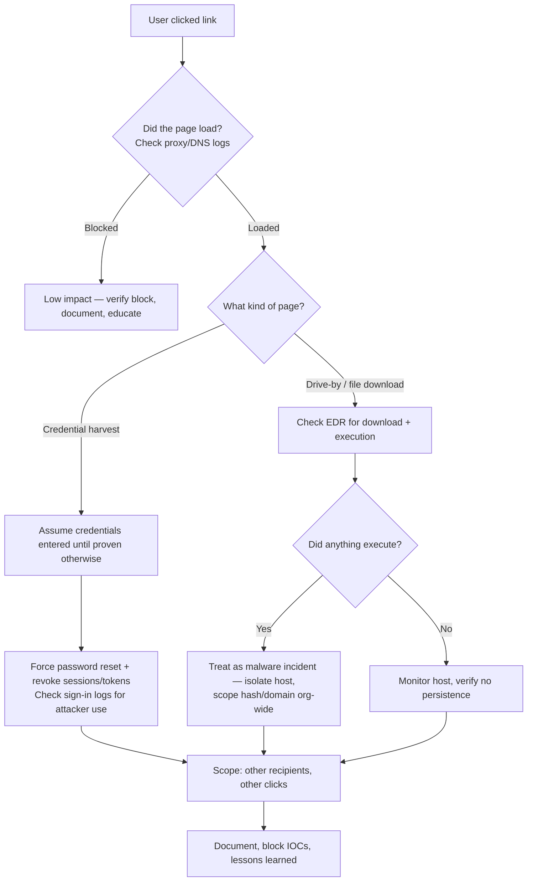
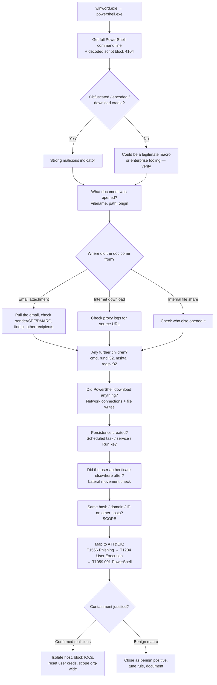

[← Back to index](README.md) | **Tier 1 — HIGHEST PRIORITY. This is the file to master.**

# Phase 16 — Incident Response Scenarios (Q370–400)

These are the questions that decide the interview. Every answer below follows the same L2 structure — internalize the *shape*, not the words:

```
1. First move (what I do in the first 60 seconds)
2. Validate — is this real?
3. Investigate — evidence chain, in order
4. Scope — how far did it go?
5. Decide — contain / escalate / close, and WHY
6. Act + document
```

> **The universal opener.** If you're ever unsure how to start an answer, say this: *"First I'd confirm the alert is real and understand exactly what fired and why — then I'd establish the scope before I take any containment action, because containment on a false positive costs the business and containment that's too narrow lets the attacker keep moving."* It buys thinking time and it's the correct L2 instinct.

---

## Email / phishing scenarios

### 370. A user reports a suspicious email. What do you do?
1. **Acknowledge and instruct** — tell the user *not* to click, reply, or delete it; ask them to leave it in place so it can be analyzed.
2. **Retrieve the original with full headers** (not a forwarded copy — forwarding destroys header fidelity).
3. **Analyze headers** — `Received` chain (actual origin), `Return-Path` vs `From` mismatch, SPF/DKIM/DMARC results, reply-to pointing elsewhere.
4. **Analyze content** — sender domain (lookalike/newly registered?), URLs (defang and check reputation, follow redirects in a sandbox — never on your own machine), attachments (hash, sandbox detonation).
5. **Determine exposure** — did *this* user click or submit anything? Check proxy/DNS logs for the URL and EDR for any file execution.
6. **Scope organization-wide** — how many others received it, how many clicked (see Q211-213).
7. **Contain** — purge/soft-delete the message from all mailboxes, block sender/domain/URL/hash at the mail gateway, proxy, and firewall.
8. **Close the loop** — thank and inform the reporting user (this is how you keep users reporting), document, and add IOCs to the blocklist and threat intel.

### 371. A user clicked a phishing link. Walk me through your investigation.



Key L2 point to say out loud: **"a click is not the incident — what happened after the click is the incident."** Confirm whether the page actually loaded (proxy/DNS/firewall logs), whether credentials were submitted (POST activity, or the user's own account), and whether anything executed (EDR file/process events).

### 372. A user entered credentials into a phishing page. What do you do?
This is now a **confirmed credential compromise** — act immediately, don't wait for the full investigation.
1. **Contain first** — reset the password AND **revoke all active sessions/refresh tokens** (a reset alone does not kill an existing stolen session token — this distinction is a very common L2 interview test).
2. **Check for attacker use already** — sign-in logs for that account: unfamiliar IPs/ASNs, countries, devices, user agents, successful sign-ins after the phishing time.
3. **Check MFA state** — was MFA satisfied? Was a *new* MFA method registered by the attacker (a classic persistence step)? Any MFA fatigue/push-bombing pattern?
4. **Check mailbox for attacker persistence** — new inbox rules (auto-forward/auto-delete, especially rules hiding "security" or "invoice" mails), delegated permissions, new OAuth app consents.
5. **Check for lateral action** — did the account access SharePoint/OneDrive/Teams, send outbound mail, or authenticate to on-prem resources after the compromise?
6. **Scope** — did other users receive the same phish and submit credentials too?
7. **Notify** the user and their manager, document fully, and add all IOCs to blocklists.

---

## Authentication / identity scenarios

### 373. One account has 500 failed logins followed by a successful login. Investigate.
The success at the end is what changes this from "noise" to "probable compromise."
1. **Characterize the failures** — same source IP or many? One account or many (500 failures on *one* account = brute force; a few failures across hundreds of accounts = password spray)? What failure reason codes?
2. **Identify the successful logon** — timestamp, source IP, geolocation/ASN, device, user agent, logon type (interactive/network/RDP), and whether MFA was satisfied.
3. **Compare success vs. failures** — same source as the failures? If yes, that's a strong brute-force success. If the success came from a *different* trusted source, it may be the legitimate user logging in coincidentally — that's the false-positive path you must rule out explicitly.
4. **Baseline the account** — does this user normally sign in from that IP/country/device/time?
5. **Post-compromise activity** — what did the account do after that logon? New processes, file access, further authentication to other hosts, mail rules, privilege changes.
6. **Check privilege** — is this a standard user or an admin/service account? That changes severity dramatically.
7. **Decide** — if the success came from the attacking source: disable/reset the account, revoke sessions, and scope for lateral movement. If MFA blocked all attempts and the success is clearly the legitimate user, document as attempted brute force, block the source IP, and confirm MFA coverage.

### 374. One account successfully authenticates from Qatar and another country within 10 minutes. Investigate.
This is **impossible travel** — and the first thing an interviewer wants to hear is that you know it's *frequently benign*.
1. **Rule out the benign explanations first** — corporate VPN egress in another country, cloud/proxy service (Microsoft datacenter IPs commonly appear as "another country"), a mobile roaming/carrier-NAT IP, or the user genuinely traveling with a second device left behind.
2. **Examine both sign-ins in detail** — IP, ASN/ISP (datacenter vs. residential vs. mobile carrier), device ID, user agent, application accessed, and whether MFA was satisfied on each.
3. **Check device familiarity** — is the second sign-in from a registered/compliant device or a brand-new unknown one? A known device from a VPN egress is benign; an unknown device from a hosting ASN is not.
4. **Check for follow-on activity** from the suspicious sign-in — mail rule creation, file downloads, app consents, privilege changes.
5. **Contact the user/manager** to confirm travel or VPN use — but note: you verify *independently first*, because "the user says it was them" can itself be an attacker (Q525).
6. **Decide** — unexplained + unfamiliar device + hosting/VPN ASN + follow-on activity → treat as compromise: revoke sessions, reset password, investigate scope. Explained by VPN/roaming → close as benign positive and tune the rule (named-location exclusions) so it stops firing on it.

### 375. A user receives an MFA fatigue attack. What do you do?
MFA fatigue (push bombing) = attacker already has valid credentials and is spamming push approvals hoping the user accepts one.
1. **Immediate**: instruct the user to **deny all prompts** and not to approve anything, no matter how persistent.
2. **Reset the password immediately** — the attacker demonstrably has the current one.
3. **Revoke all sessions/tokens.**
4. **Check whether any prompt was approved** — if yes, this is a full account compromise: proceed as Q372/Q190.
5. **Check for attacker persistence** — new MFA methods registered, new devices, inbox rules, app consents.
6. **Determine how the password leaked** — prior phishing, credential stuffing from a public breach, infostealer malware on the user's endpoint (check EDR).
7. **Harden** — enable number matching / push challenge in Conditional Access, consider phishing-resistant MFA (FIDO2), and set sign-in risk policies. Say this part out loud — L2 answers include the systemic fix, not just the incident.

### 376. An administrator account shows suspicious login activity. What do you do?
Privileged account = escalate severity immediately and treat as potential domain-level compromise.
1. **Escalate/notify** per policy right away — an admin compromise usually meets the bar for immediate IR involvement rather than routine triage.
2. **Validate the sign-in** — source IP, device, time, MFA state, logon type, and whether it matches the admin's normal pattern (admins should have tightly baselined behavior).
3. **Check for privilege abuse** — group membership changes (4728/4732), new accounts created (4720), new services (4697/7045), GPO changes, role assignments in Entra.
4. **Check lateral movement** — where else did this account authenticate (4624 across hosts, especially domain controllers)?
5. **Check for credential dumping activity** on any host it touched (LSASS access).
6. **Contain carefully** — disabling a domain admin account can break production services, so coordinate with the identity/AD team; but if compromise is confirmed, reset credentials (including any service dependencies) and revoke sessions.
7. **If DC-level compromise is suspected**, the krbtgt account may need a double reset — that's an L3/IR decision, and knowing to *raise* it is the L2 signal.

---

## Endpoint / process scenarios

### 377. A workstation starts executing PowerShell commands from an unusual parent process. Investigate.
1. **Get the full process tree** — what is the parent, and the parent's parent? (Office app? `mshta`? A service?)
2. **Get the full PowerShell command line and decoded script block** (4104) — decode any `-EncodedCommand` base64; this is where the truth is.
3. **Look for malicious markers** — download cradles (`DownloadString`, `Invoke-WebRequest`), `-nop -w hidden -ExecutionPolicy Bypass`, in-memory execution, obfuscation.
4. **Check network activity** from the PowerShell process — destination, reputation, whether anything was downloaded.
5. **Check file system changes** — what did it write, and where?
6. **Check persistence** — new scheduled task, service, or Run-key added around the same timestamp.
7. **Check user context and baseline** — does this user/host ever run PowerShell legitimately?
8. **Scope** — same pattern on other hosts?
9. **Decide** — malicious markers + unusual parent + network callout = isolate the host and treat as active compromise.

### 378. winword.exe → powershell.exe appears on a workstation. Is it malicious? How do you investigate?
This is *the* canonical L2 question — the question bank itself calls it out. **Never answer "yes, block it."** The correct answer is: *highly suspicious, because Word has no legitimate reason to spawn a shell, but I'd prove it before acting.*



Narrate that whole chain in the interview and you have given an unambiguously L2 answer.

### 379. outlook.exe → powershell.exe appears. What would you check?
Same logic as 378, but the delivery vector is almost certainly **an email attachment or a link opened directly from Outlook**:
- Full PowerShell command line / script block.
- **Which email** was open/being interacted with at that timestamp — sender, subject, attachment name and hash.
- Whether the attachment was saved and executed (EDR file events).
- Whether the sender is external, spoofed (SPF/DKIM/DMARC fail), or a known-compromised internal account (BEC).
- **All other recipients of the same email** — this is the scoping step that turns one host into a campaign.
- Network callouts, persistence, and subsequent authentication activity, as in 378.

### 380. excel.exe → cmd.exe → powershell.exe appears. Investigate.
The three-level chain is *more* suspicious than a two-level one — `cmd.exe` as an intermediary is a common macro pattern used to obscure the eventual payload.
1. Full command line at **each** level of the chain (Excel's document, cmd's arguments, PowerShell's decoded script).
2. Identify the workbook — name, path, origin (email? download? shared drive?), and whether macros were enabled.
3. Check for the classic follow-ons: `certutil`/`bitsadmin` download, `rundll32`/`regsvr32` execution, a dropped binary in `%TEMP%`/`%APPDATA%`.
4. Network connections and any downloaded payload's hash → reputation check.
5. Persistence check and lateral movement check.
6. Scope the workbook hash and any C2 domain/IP across all endpoints.
7. Map to ATT&CK and decide containment.

### 381. A user downloads an executable from the internet and runs it. Investigate.
1. **Identify the file** — full path, filename, **SHA256 hash**, digital signature status, size.
2. **Reputation check the hash** — VirusTotal/internal TI. Unknown ≠ safe; brand-new hashes are common for targeted malware.
3. **Source URL** — from proxy/DNS logs: is the domain newly registered, low-reputation, a known distribution site, or a legitimate software vendor?
4. **Execution behavior** — child processes, DLLs loaded, files written, registry changes, network connections after execution.
5. **Persistence** — did it install a service, scheduled task, or Run key?
6. **Credential access** — did it touch LSASS or browser credential stores (infostealers do this within seconds)?
7. **Scope** — same hash or same source URL on other endpoints?
8. **Decide** — malicious → isolate, block hash and domain globally, remediate, and reset any credentials that could have been harvested. Benign (legit tool, e.g. an admin installing PuTTY) → close as benign positive and note whether it violates software policy.

---

## Network / C2 scenarios

### 382. A machine connects to a known malicious IP. What do you do?
1. **Validate the intel** — how "known" is known? Which feed, what confidence, how recent? (Stale IOCs are a real false-positive source: IPs get reassigned — see Q444 IOC aging.)
2. **Determine direction and outcome** — outbound or inbound? Was the connection **allowed or blocked** by the firewall/proxy? A blocked connection is a very different severity.
3. **Identify the process** that initiated it (EDR/Sysmon Event 3) and its full lineage — this tells you whether it's malware or, say, a browser hitting a compromised ad network.
4. **Assess the pattern** — single connection vs. repeated beaconing at a fixed interval.
5. **Check data volume** — large outbound transfer suggests exfiltration, small regular transfers suggest C2 heartbeat.
6. **Scope** — which other hosts contacted the same IP/domain?
7. **Decide** — confirmed malicious process + successful connection → isolate the host, block the IP at the perimeter, hunt the responsible binary org-wide. Blocked connection from a browser → likely low severity, document and monitor.

### 383. A machine makes periodic connections to the same external IP every 60 seconds. What does this suggest?
**Beaconing — classic command-and-control.** Say that immediately, then justify: regular, fixed-interval, low-volume connections are the signature of malware checking in for instructions. Legitimate software does poll on intervals too (update checks, monitoring agents, telemetry), so:
1. Identify the **process** making the connections and whether it's signed/known.
2. Check **jitter** — perfectly regular timing (exactly 60s) is more machine-like; some C2 adds randomization, so mild jitter doesn't rule it out.
3. Check **destination reputation, domain age, ASN, and certificate/JA3** — newly registered domains and self-signed certs are strong signals.
4. Check **payload size consistency** — C2 heartbeats are typically small and uniform.
5. Check **duration** — has it been running since a specific event (a phishing click, a software install)?
6. **Scope** — other hosts beaconing to the same destination.
7. If confirmed: isolate, block, identify the implant binary and its persistence, and hunt for the initial access vector.

### 384. Multiple endpoints communicate with the same unusual domain. Investigate.
Multiple hosts to one unusual destination = either a **common malware distribution/C2** or a **legitimate service you haven't baselined**. Both are common — determine which.
1. **Enumerate the affected hosts** and look for what they share (same department, same software, same recent email, same patch level).
2. **Domain intel** — registration date (newly registered = strong signal), registrar, hosting ASN, passive DNS, certificate details, reputation.
3. **Identify the process** on each host making the request — same binary on all of them? That's your implant.
4. **Look for a common initial vector** — did they all receive the same email, visit the same site, or install the same update?
5. **Traffic characteristics** — beaconing pattern, data volume, protocol.
6. **Decide** — if malicious: block the domain org-wide immediately (this one action protects everyone), then isolate affected hosts by priority and hunt the delivery mechanism.

### 385. DNS traffic suddenly increases dramatically from one host. Investigate.
Prime suspect: **DNS tunneling** (exfiltration or C2 over DNS).
1. **Look at the queries themselves** — long, high-entropy, random-looking subdomains under one parent domain is the tunneling signature.
2. **Check record types** — heavy TXT, NULL, or CNAME usage is abnormal for normal browsing.
3. **Check the parent domain** — one domain receiving thousands of unique subdomain queries is the giveaway.
4. **Identify the querying process** on the host.
5. **Rule out benign causes** — a misconfigured application in a retry loop, a security scanner, an antivirus reputation lookup service, or a broken DNS cache can all spike volume without being malicious.
6. **Check for corresponding data volume** and whether the host had a prior compromise indicator.
7. **Decide** — confirmed tunneling → isolate the host, block the domain, and treat as active exfiltration/C2 with full scoping.

### 386. One workstation scans hundreds of internal IP addresses. Investigate.
**Internal reconnaissance** — a workstation has no legitimate reason to port-scan the network.
1. **Identify the process** performing the scan (nmap? a PowerShell script? a legitimate vulnerability scanner agent?).
2. **Rule out authorized scanning first** — is this host a sanctioned vulnerability scanner or asset-discovery tool? Check with IT/infra. This is the #1 false positive here.
3. **Characterize the scan** — which ports (445/3389/22 focus suggests lateral movement targeting), sequential vs. randomized, speed.
4. **Determine how the host got the capability** — was a tool downloaded? Check for the initial compromise that preceded this (recon rarely happens first).
5. **Check if any connections succeeded** and whether authentication followed on scanned hosts.
6. **Check the user context** — running as the logged-on user or SYSTEM?
7. **Decide** — unauthorized scanning → isolate immediately (recon means the attacker is *actively* working and about to move), then hunt for initial access and any successful lateral movement. Maps to ATT&CK Discovery (T1046 Network Service Discovery).

---

## Lateral movement / AD scenarios

### 387. Multiple machines suddenly authenticate to one workstation. Investigate.
The *direction* is what makes this odd — workstations don't normally receive inbound authentication from many peers.
1. **Characterize the authentications** — Event 4624 on the target: which accounts, which logon types (3 = network/SMB, 10 = RDP), which source hosts.
2. **Is one account being used across all of them?** That suggests a compromised credential being reused, with this workstation as a collection point or pivot.
3. **Is this workstation actually a server/shared resource in disguise?** (Someone hosting a share, a print queue, or a dev service — a real false-positive path.)
4. **Check what happened on the target** after each authentication — file access, process creation, service installation.
5. **Check the source hosts** — are *they* compromised, making this the second hop of a lateral movement chain?
6. **Check timing** — a tight burst suggests automation/tooling rather than organic user activity.
7. **Decide** — unexplained many-to-one authentication is treated as active lateral movement: isolate the target, reset the involved credentials, and expand scoping to every source host.

### 388. A new administrator account is created unexpectedly. Investigate.
1. **Get the creation event** — 4720 (account created) plus 4728/4732 (added to admin group): **who** created it, from **which host**, at what time.
2. **Check the creator's legitimacy** — is that account itself compromised? Was this outside change-management/ticketing (check for an approved change request — the fastest way to resolve it either way)?
3. **Check the new account's naming** — attackers often mimic service accounts (`svc_backup`, `admin_helpdesk`) or use near-copies of real admins.
4. **Check what the new account has done** since creation — any logons, any access.
5. **Check for parallel persistence** — new services, scheduled tasks, or other accounts created around the same timestamp (attackers rarely plant just one).
6. **Check for the preceding compromise** — how did the creator get the privilege to do this?
7. **Decide** — no matching change request → disable the account immediately (this one is cheap to reverse and expensive to leave), preserve it for evidence rather than deleting, and escalate as confirmed privilege escalation/persistence.

### 389. A user is added to Domain Admins. What do you do?
Highest-privilege group in the domain — treat as critical until proven authorized.
1. **Identify the change** — Event 4728, who performed it, from where, when.
2. **Verify authorization** — approved change request/ticket? Confirm directly with the identity team, not just from the log.
3. **If unauthorized: remove the membership immediately** — this is one of the few containment actions justified before full investigation completes, because standing Domain Admin is catastrophic.
4. **Investigate the actor account** — how did it obtain the rights to make this change, and is it itself compromised?
5. **Investigate the added account** — what has it done since? Logons to DCs, DCSync-style replication activity, credential dumping.
6. **Scope for parallel persistence** — other group changes, new accounts, new services, GPO modifications.
7. **Escalate to IR** — unauthorized Domain Admin addition is typically an incident-command-level event, and if DC compromise is suspected, krbtgt reset enters the conversation.

### 390. Windows Event Log was cleared. What does that indicate?
**Anti-forensics / defense evasion (ATT&CK T1070.001).** Legitimate log clearing is rare and almost always tied to a documented maintenance action.
1. **Get Event ID 1102** — who cleared it, on which host, at what time.
2. **Establish what you lost** — which channel, and what time window is now missing.
3. **Pivot to sources the attacker can't clear** — this is the key L2 move: SIEM-forwarded copies of the logs (already off the box), EDR telemetry, Sysmon (separate channel), network/firewall/proxy logs, DHCP, and DC-side authentication records.
4. **Investigate the account that cleared it** — is it a legitimate admin, and can they account for the action?
5. **Look at what happened immediately before the clear** — that window is precisely what the attacker wanted hidden.
6. **Treat as confirmed malicious until proven otherwise** and escalate — log clearing is one of the strongest single indicators of a hands-on-keyboard intruder.

### 391. A suspicious service is created on multiple machines. Investigate.
Service creation across multiple hosts = **automated lateral movement + persistence** (the PsExec signature).
1. **Get the service details** — Events 7045/4697: service name, binary path, account it runs as, on each host.
2. **Look at the binary path** — random-character service names, binaries in `%TEMP%`/`ADMIN$`, or a command line embedding PowerShell/cmd are classic PsExec-style indicators.
3. **Identify the creating account** — one compromised credential used across all hosts is the usual pattern.
4. **Identify the source host** — where did the remote service creation originate? That's likely patient zero or the pivot point.
5. **Hash the service binary** and check reputation; scope the hash environment-wide.
6. **Check what the service did** — network connections, child processes.
7. **Decide** — isolate affected hosts, disable the credential being used, remove the services, and treat as an active intrusion with lateral movement in progress. Escalate.

### 392. A server suddenly starts communicating with an unknown external IP over port 4444.
Port 4444 = Metasploit default listener; a **server** doing this is worse than a workstation (higher value, usually tighter egress policy).
1. **Identify the process** and full lineage on the server.
2. **Check whether the connection succeeded** and whether it's beaconing or a sustained session (a sustained connection suggests an interactive reverse shell — attacker hands on keyboard *right now*).
3. **Check the destination** — reputation, ASN, geolocation, first-seen.
4. **Check how the process got there** — recently written binary? Web shell on an internet-facing app? Exploited service? Check web server logs if it's a web-facing server.
5. **Check for credential access** on the server (LSASS access, SAM/registry dumps) — servers hold service-account credentials.
6. **Check for lateral movement** from the server outward.
7. **Decide** — high confidence C2 on a server: isolate/network-contain immediately (weighing business impact and coordinating with the system owner — see Q419), preserve memory if possible, and escalate to IR. Block the IP at the perimeter for the whole environment.

---

## Ransomware scenarios

### 393. A user reports files being renamed with an unknown extension.
This is very likely **ransomware encryption in progress** — speed matters more than certainty here.
1. **Immediately isolate that endpoint from the network** — this is the rare case where containment precedes full investigation, because every minute of delay is more encrypted files and possible spread to file shares.
2. **Confirm** — check the extension against known ransomware families, look for a ransom note file in the affected directories.
3. **Identify the encrypting process** via EDR and kill/block it.
4. **Determine scope urgently** — are network shares affected? Are other endpoints showing the same file-modification pattern? Check for mass file-modification events across the estate.
5. **Identify entry vector** — phishing attachment, exposed RDP, exploited vulnerability, malicious download.
6. **Escalate to IR/management immediately** — ransomware is always a major incident with business, legal, and possibly regulatory implications.
7. **Preserve evidence** (don't wipe the machine — memory and disk may be needed, and sometimes decryptors depend on artifacts) and check backup integrity.

### 394. Several machines begin encrypting files simultaneously.
Full-blown **ransomware outbreak**. The answer here should sound decisive and prioritized.
1. **Declare a major incident and escalate immediately** — this is beyond routine L2 triage; incident command, management, and business continuity need to be engaged now.
2. **Contain aggressively and broadly** — isolate affected hosts; if spread is rapid, consider network-segment-level containment (blocking SMB between segments, disabling the compromised account domain-wide) rather than host-by-host, which won't keep pace.
3. **Protect the crown jewels first** — domain controllers, backup infrastructure, and file servers. Attackers deliberately target backups before detonating.
4. **Identify and disable the propagation mechanism** — usually a compromised privileged account plus SMB/PsExec/GPO/scheduled task deployment.
5. **Identify patient zero and the entry vector** in parallel (don't let this block containment).
6. **Verify backup integrity and isolation** — offline/immutable copies.
7. **Preserve evidence** throughout for forensics, insurance, and any law-enforcement/regulatory reporting.

Say the ordering rationale out loud: **containment and backup protection outrank root-cause analysis during an active outbreak** — you can investigate a contained environment, but you can't un-encrypt one.

---

## Credential access / DC scenarios

### 395. A domain controller shows unusual authentication activity.
DCs are the highest-value target in the environment — anything unusual here is critical by default.
1. **Characterize "unusual"** — volume spike, off-hours, unfamiliar source hosts, unusual accounts, or unusual protocols/ticket types.
2. **Check for replication requests from non-DC sources** — this is the **DCSync** signature and is one of the most important things to catch on a DC.
3. **Check Kerberos anomalies** — bursts of 4769 service ticket requests (Kerberoasting), tickets with abnormal lifetimes or encryption types (Golden Ticket indicators), 4771 pre-auth failures.
4. **Check interactive/RDP logons to the DC** — administrators should rarely log on interactively to DCs; that's a strong signal.
5. **Check for LSASS access / credential dumping on the DC itself.**
6. **Check for new accounts, group changes, GPO modifications** originating there.
7. **Escalate immediately** — suspected DC compromise is an L3/IR event; your job as L2 is to establish the evidence quickly and hand it over cleanly with a timeline.

### 396. You discover LSASS access from an unknown process.
**Credential dumping (T1003.001)** until proven otherwise — one of the highest-fidelity signals in all of endpoint security.
1. **Identify the accessing process** — full path, hash, signature status, parent process, command line.
2. **Check the access mask** — read access to LSASS memory (e.g., `0x1010`, `0x1410`) is the meaningful pattern; some benign tools open handles with harmless rights.
3. **Rule out legitimate accessors** — AV/EDR agents, backup software, some monitoring tools legitimately touch LSASS. Maintain a known-good list; anything outside it is suspect.
4. **Check for a dump file written to disk** (`lsass.dmp` or similar) around the same time — and for exfiltration of it.
5. **Assume the credentials on that host are compromised** — enumerate every account that had a session on that machine.
6. **Check for immediate reuse** — authentication from that host to others (Pass-the-Hash/Pass-the-Ticket) right after the dump.
7. **Decide** — isolate the host, force password resets for every account with a session on it (including service accounts and any admin who logged on there), and scope for lateral movement. Escalate.

### 397. You detect possible credential dumping. What do you do?
1. **Confirm the technique** — LSASS memory access, SAM/SYSTEM registry hive export, `ntdsutil`/NTDS.dit copy on a DC, or a known tool signature (Mimikatz, procdump, comsvcs.dll MiniDump via rundll32).
2. **Isolate the affected host** — the attacker is at the credential-access stage, meaning lateral movement is imminent; this justifies fast containment.
3. **Enumerate exposed credentials** — every account with a logon session on that host, including cached domain credentials and service accounts.
4. **Reset those credentials** in priority order: privileged accounts first, then service accounts (coordinated to avoid outages), then users.
5. **Hunt for downstream use** — authentication from that host or with those accounts to other systems since the dump time.
6. **If a DC or a Domain Admin credential was exposed**, escalate for a possible krbtgt double-reset decision.
7. **Document precisely which credentials were exposed and when** — this drives the whole remediation plan and is exactly what IR will ask you for.

### 398. You detect lateral movement from one workstation to 20 servers. Investigate.
Twenty hosts means an automated, credentialed, hands-on-keyboard intrusion — this is a major incident.
1. **Escalate immediately** while you investigate — don't sit on this.
2. **Identify the source workstation and the credential(s)** being used — one compromised privileged account is the usual enabler.
3. **Identify the movement technique** — SMB/PsExec (7045 service creation), WMI, WinRM/PowerShell remoting (5985/5986), RDP (4624 type 10), or scheduled tasks.
4. **Build the timeline** — which server was touched first, in what order, and what happened on each after access.
5. **Determine what was done on the servers** — data staged/collected? Additional persistence? More credential dumping? Ransomware precursors?
6. **Contain** — disable the compromised account (coordinating with the account owner if it's a service account with production dependencies), isolate the source workstation, and isolate the most critical affected servers.
7. **Scope beyond the 20** — assume the list is incomplete until you've queried authentication logs for that credential across the whole estate.
8. **Determine initial access** on the source workstation — that's the gap that has to be closed or it happens again.

---

## Major incident scenarios

### 399. A critical server is compromised. What is your response?
The word "critical" changes the calculus — containment now has real business consequences, and an L2 answer must show you weigh that.
1. **Escalate and engage stakeholders immediately** — IR team, the system owner, and management. You do not unilaterally take a critical production server offline.
2. **Assess the compromise** — what access does the attacker have, what's the evidence, is it still active?
3. **Weigh containment options with the business** — full network isolation vs. targeted blocking (kill the C2 destination at the firewall, disable the compromised account, block the malicious process) that preserves service availability. Present options with risk, don't just ask permission.
4. **Preserve evidence before remediation** — memory capture and disk image if forensics is required; rebuilding destroys the evidence trail.
5. **Determine data exposure** — what data does this server hold, and is there evidence it was accessed or exfiltrated? This drives regulatory/notification obligations.
6. **Scope laterally** — service accounts on that server are now suspect everywhere they're used.
7. **Plan eradication and recovery with the owner** — usually rebuild from known-good rather than clean-in-place for a confirmed compromise, plus credential rotation for everything the server held.

### 400. You discover data exfiltration from a server. What do you do?
1. **Stop the outflow first** — block the destination IP/domain at the perimeter, and if justified, isolate the server. Exfiltration is ongoing damage.
2. **Quantify** — how much data, over what period, to where? Firewall/proxy byte counts and session durations give you volume; this number will be the first question management asks.
3. **Identify what data** — what does this server host, which files/database tables were accessed, and by which account/process?
4. **Identify the channel** — HTTPS upload, DNS tunneling, cloud storage service, FTP, email? Each has different log sources.
5. **Determine the actor and access path** — compromised account, web shell, insider, or malware.
6. **Escalate immediately** — data exfiltration has legal, regulatory, and reputational consequences; legal/compliance and management must be engaged early, and in a government/national-security context this may carry mandatory reporting obligations.
7. **Preserve all evidence** with chain of custody — exfiltration incidents are the ones most likely to end up in a formal investigation.
8. **Scope** — is the same channel or account being used from other systems?

---

## The five sentences that make any answer sound L2

Keep these in your pocket and use them verbatim:

1. *"Before I act, I'd confirm what actually fired and whether it's a true positive — containment on a false positive has a real business cost."*
2. *"I'd pull the full process tree and command line, because the process name alone doesn't tell me intent."*
3. *"Then I'd scope it — I'd check whether the same hash, domain, IP, or account pattern appears on any other host, because one host is a finding and twenty is an incident."*
4. *"I'd map it to ATT&CK so the report describes the attacker's behavior, not just the alert."*
5. *"I'd weigh the containment action against business impact and escalate if it exceeds my authority — but I'd never delay containment on an active, confirmed compromise."*

---
[← Back to index](README.md) · [← Phase 15](phase-15-linux.md) · [Next: Phase 17 — Advanced L2 Investigation →](phase-17-advanced-l2-investigation.md)
