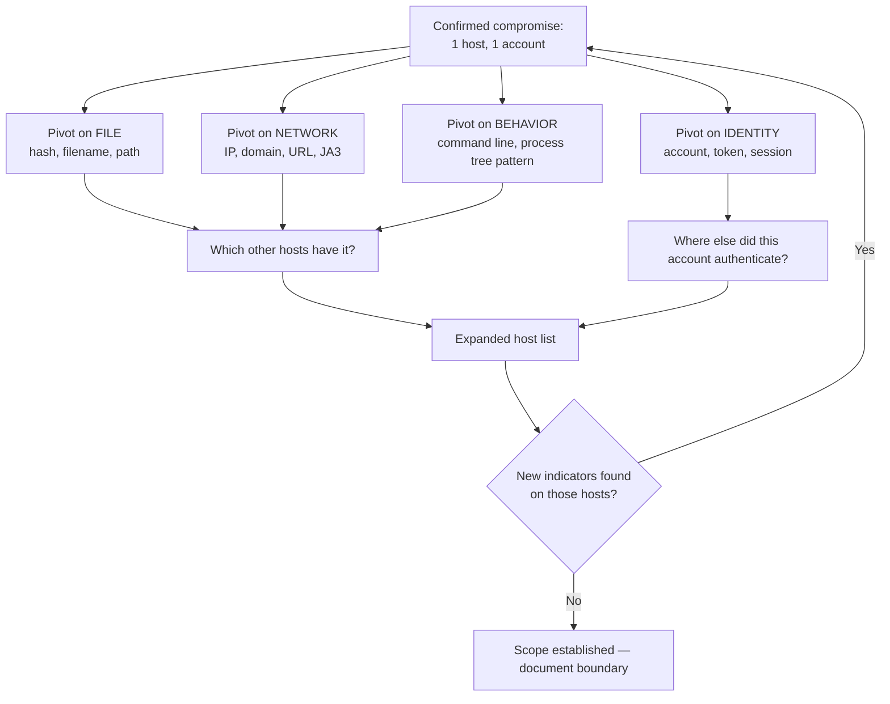

[← Back to index](README.md) | **Tier 1 — Highest priority alongside Phase 16 and 25**

# Phase 17 — Advanced L2 Investigation (Q401–420)

Phase 16 is *what you do* in specific scenarios. This phase is *how you think* — the reasoning that generalizes to any scenario the interviewer invents on the spot. If they throw you a scenario you've never seen, these are the methods you fall back on.

## 401. How do you establish a timeline during an incident?
1. **Fix a reference clock** — normalize everything to a single timezone (UTC is standard) and account for log sources with clock skew. Say this: mixing local and UTC timestamps is how analysts build wrong timelines.
2. **Anchor on a known event** — the alert time, the phishing email delivery, the first suspicious process.
3. **Work backwards** to find the earliest evidence (initial access), then **forwards** to find the latest (current state).
4. **Merge sources into one ordered sequence** — endpoint (process/file/registry), authentication (Windows/Entra), network (firewall/proxy/DNS), email, and cloud audit logs.
5. **Record what each entry proves**, not just what it says — a 4624 proves an authentication succeeded, not that the legitimate user performed it.
6. **Mark the gaps explicitly** — where you have no visibility is as important as where you do, because that's where the attacker may have operated unseen.

## 402. How do you determine the initial access vector?
Work backwards from the earliest confirmed malicious activity and ask "what immediately preceded this?"
- Suspicious process → what was its **parent**? Keep walking up the tree until you reach something user-initiated or externally-triggered.
- Landed on an Office app → check **email** (attachment/link) at that time.
- Landed on a browser → check **proxy/DNS** history for the download or drive-by.
- No user process involved at all → check **internet-facing services** on that host (web shell, exploited vulnerability, exposed RDP/VPN).
- Authentication with no preceding malware → check for **credential compromise** from elsewhere (phishing, password spray, reused credential from a public breach).

The honest L2 answer includes: *"and if I can't establish it definitively, I say so and document the most probable vectors with the evidence for each, rather than guessing."*

## 403. How do you identify the patient zero?
Patient zero = the **first** compromised host/account, chronologically.
1. Collect every confirmed-affected host/account.
2. Compare the **earliest** confirmed malicious activity timestamp on each.
3. Look for the host that has no *inbound* attacker activity (nothing moved laterally *to* it) but does have outbound — that's usually the origin.
4. Confirm by finding an external entry point on it (email, download, exploited service) rather than an internal one.
5. Beware timestamp traps: the host that *alerted* first is often not the one that was *compromised* first — detection order ≠ compromise order. Saying this out loud is a strong L2 signal.

## 404. How do you determine the scope of compromise?
Pivot on every available indicator, across every log source:

The loop is the point: each newly found host yields new indicators, which yield more hosts, until the search stops returning anything new. **Scope is not established until a full pivot cycle returns nothing new.**

## 405. How do you distinguish attacker activity from legitimate administrator activity?
This is one of the hardest and most-asked L2 discrimination questions, because admins and attackers use the same tools.

| Check | Legitimate admin | Attacker |
|---|---|---|
| **Change record** | Has an approved ticket/change window | Nothing in the change system |
| **Source host** | Their normal admin workstation / PAW / jump box | A user workstation, an unusual server, or an external IP |
| **Timing** | Business hours or a scheduled maintenance window | Off-hours, weekends, holidays |
| **Account used** | Their own named admin account | Shared/service accounts, a newly created account, or a user account that suddenly has admin rights |
| **Pattern** | Targeted — does the one task and stops | Exploratory — enumeration, broad discovery, touching many systems |
| **Tooling** | Sanctioned tools/paths, signed binaries | LOLBins with odd arguments, tools run from `%TEMP%`, obfuscated commands |
| **Sequencing** | Task fits a known operational purpose | Follows a kill-chain shape: recon → cred access → lateral movement |

And the definitive step: **just ask them.** Contact the admin/system owner and ask if they performed the action. But — critically — verify independently too, because an attacker using a compromised admin account will produce an admin who genuinely says "that wasn't me," and a *compromised* admin account is exactly the case you can't resolve by asking alone.

## 406. How do you determine whether a suspicious PowerShell command is malicious?
1. **Decode it fully** — base64/`-EncodedCommand`, string-concatenation obfuscation, character replacement. Get to the real script (Event ID 4104 script block logging gives you this de-obfuscated).
2. **Read what it actually does** — download? Execute in memory? Enumerate AD? Access credentials? Modify security settings?
3. **Check the flags** — `-nop -w hidden -ExecutionPolicy Bypass -enc` in combination is very hard to explain innocently.
4. **Check the parent process** — `explorer.exe` from an admin's session vs. `winword.exe`.
5. **Check the destination** of any network call — reputation, domain age.
6. **Check the user and host baseline** — does this person run PowerShell at all?
7. **Check the outcome** — what did it actually produce (files, processes, connections)?
8. **Consider the legitimate explanation honestly** — enterprise management tools (SCCM/Intune) run encoded PowerShell routinely. If the parent is a known management agent and the script matches known tooling, that's a benign positive.

## 407. How do you correlate multiple log sources?
Correlate on **shared entities** — the pivot keys that appear across sources:
- **Time** (normalized) — the universal join.
- **IP address** — firewall ↔ proxy ↔ EDR network events ↔ sign-in logs.
- **Hostname / device ID** — EDR ↔ Windows events ↔ vulnerability data.
- **Username / UPN** — Windows auth ↔ Entra sign-ins ↔ email ↔ cloud audit.
- **File hash** — EDR ↔ email attachments ↔ proxy downloads ↔ threat intel.
- **Domain / URL** — DNS ↔ proxy ↔ email ↔ TI.

In Sentinel this is `join` on a shared key or `union` across tables plus a common filter (see [phase-12 KQL](phase-12-kql.md)). The conceptual answer: pick the entity that persists across the attack (usually the account or the host), then reconstruct its full activity from every table that references it.

## 408. What would you do if logs are missing?
1. **Determine why** — retention expired, agent stopped, connector broken, log level not enabled, or **deliberately cleared by the attacker** (Event 1102 — which is itself evidence).
2. **Find substitutes** — almost everything leaves a trace in more than one place:

| Missing | Substitute with |
|---|---|
| Endpoint process logs | EDR telemetry, Sysmon, prefetch/AmCache/ShimCache artifacts, memory |
| Local Windows Security log | SIEM-forwarded copy (already off-box), DC-side auth events |
| Proxy logs | DNS logs, firewall connection logs, netflow |
| Email gateway logs | Mailbox audit logs, the message itself in the mailbox |
| Firewall logs | Netflow, EDR network events, DNS |

3. **Document the gap explicitly** in the incident record and state what you could and could not determine because of it.
4. **Raise it as a remediation item** — a visibility gap found during an incident is a detection-engineering finding, and saying that unprompted is a strong L2 signal.

## 409. What would you do if EDR isn't available?
Fall back to the layered sources: Windows Event Logs (4688 process creation, 4624/4625 auth), Sysmon if deployed, PowerShell script block logs, firewall/proxy/DNS logs, email gateway, and — for a single host — live triage or forensic artifacts (prefetch, AmCache, registry autoruns, scheduled tasks, `netstat`, running process list). You lose real-time behavioral detection and remote isolation capability, so you compensate with network-level containment (firewall block, switch port, disable the account) instead of host isolation.

## 410. What would you do if firewall logs aren't available?
Use proxy logs (richer for web traffic anyway — full URLs), DNS logs (nearly every connection starts with a lookup), EDR network telemetry (per-process connections, which firewall logs can't give you), netflow/router data, and destination-side logs (web server access logs). Note the trade: you lose the authoritative allow/deny verdict, so you may not know whether a connection actually succeeded — which matters for severity.

## 411. How do you investigate an incident with incomplete evidence?
1. **State a hypothesis** and identify which evidence would confirm or refute it.
2. **Work from what you do have**, ranked by reliability — direct evidence over inference.
3. **Use the absence of evidence carefully** — "no EDR alert" is not "nothing happened" if EDR coverage on that host is unknown. Distinguish *"we looked and found nothing"* from *"we couldn't look."*
4. **Assign confidence levels** to conclusions (confirmed / probable / possible) rather than presenting inference as fact.
5. **Take the safer action under uncertainty** on high-impact possibilities — if you can't rule out credential theft, reset the credentials; the cost is low and the downside of being wrong is high.
6. **Document exactly what was unknown and why**, so whoever picks it up later (or L3) knows the boundaries of what was established.

## 412. How do you preserve evidence?
- **Order of volatility** — capture the most perishable first: memory (RAM), then network connections/running processes, then disk, then backups/archives.
- **Don't power off** a machine you may need memory from; isolate it from the network instead (this is a favorite interview detail).
- **Hash everything** you collect (SHA256) at collection time, and verify the hash afterwards to prove integrity.
- **Work on copies**, never originals — forensic images, not the live disk.
- **Log every action** you take on the system, with timestamps and who did it.
- **Maintain chain of custody** (Q414) for anything that could be needed legally.
- **Extend log retention** for the affected systems/timeframe before it rolls off.

## 413. What is a forensic timeline?
A single, chronologically ordered, normalized reconstruction of everything relevant that happened across all systems and log sources during an incident — each entry carrying timestamp (UTC), source system, log source, entity involved, action, and evidentiary reference. It's the deliverable that turns scattered evidence into a narrative of the attack, and it's what an incident report, a legal proceeding, or a post-incident review is built on.

## 414. What is chain of custody?
The documented, unbroken record of who collected each piece of evidence, when, how, where it has been stored, and every person who has handled or accessed it since. It exists to prove the evidence hasn't been altered or tampered with, which is what makes it admissible/credible in legal or disciplinary proceedings. Practical elements: unique evidence ID, collection timestamp and collector, hash values, storage location and access controls, and a signed transfer log for every handoff.

## 415. When would you escalate an incident to L3/IR?
- Confirmed compromise of a **domain controller, critical server, or privileged/admin account**.
- Evidence of **active hands-on-keyboard** attacker presence.
- **Ransomware** or destructive activity, at any scale.
- **Confirmed data exfiltration** or exposure of regulated/sensitive data.
- **Widespread scope** — many hosts, or lateral movement across segments.
- Anything requiring **forensic analysis, malware reverse engineering, or memory analysis** beyond your tooling/authority.
- Containment actions that exceed your authority or carry major business impact.
- When you're **stuck** — not knowing is fine; sitting on an unresolved serious incident is not.

## 416. When would you contact the system owner?
- To verify whether observed activity was authorized/expected (the fastest FP/BP resolution there is).
- Before taking containment action that will disrupt their service.
- To understand the system's business criticality, data sensitivity, and dependencies.
- To coordinate remediation, patching, or rebuild.
- To understand what "normal" looks like on that system — owners know their baselines better than any SIEM does.

## 417. When would you isolate a machine?
**Isolate when the risk of continued attacker activity outweighs the cost of the host being offline.** Concretely:
- Confirmed active malware execution or C2 communication.
- Ransomware encryption activity (immediately, no debate).
- Confirmed credential dumping.
- Active lateral movement originating from the host.
- Confirmed hands-on-keyboard intrusion.

**Weigh it more carefully when** the host is a critical production server (coordinate with the owner — consider targeted blocking instead), when evidence is weak (a single low-confidence alert), or when isolating would destroy volatile evidence you need. And remember: **isolate rather than power off**, so memory is preserved and the EDR agent keeps reporting.

## 418. When should you disable an account?
- Confirmed credential compromise (phished credentials submitted, brute-force success, MFA fatigue approval).
- Account is actively being used by an attacker.
- Unauthorized privileged account discovered (disable, don't delete — preserve evidence).
- Insider threat with active malicious action.

Prefer **password reset + session/token revocation** for a normal user whose credentials leaked (keeps them working while cutting the attacker off); prefer **full disable** when the attacker's activity is ongoing or the account itself is attacker-created. For **service accounts**, always check dependencies before disabling — disabling a service account can take down production, so coordinate first unless the compromise is severe enough to justify the outage.

## 419. What if containment could disrupt a critical business system?
This question is specifically testing business judgment, which is the L2/L3 differentiator. The answer is *not* "security comes first, isolate it anyway."
1. **Quantify both sides** — what's the risk of leaving it running (data loss, spread, encryption) vs. the cost of downtime (revenue, safety, service to citizens)?
2. **Look for a middle option** — targeted containment often achieves most of the benefit at a fraction of the cost: block the C2 destination at the firewall, kill/block the malicious process, disable just the compromised account, apply a host firewall rule, or segment the host rather than fully isolating it.
3. **Escalate the decision to someone with the authority to accept the business risk** — the system owner and management make that call, not the SOC analyst. Your job is to give them an accurate, clear risk picture and a recommendation.
4. **If you must wait, increase monitoring** — put eyes on that host continuously so you can act the moment the balance shifts.
5. **Document the decision and who made it.**

## 420. How do you balance security and business impact?
Frame it as risk management, not absolutism:
- Match the response's severity to the threat's severity — not every alert justifies isolation.
- Prefer the **least disruptive action that actually contains the threat**.
- Bring the business into decisions that affect the business; bring security expertise, not just a demand.
- Know when the answer is unambiguous: active ransomware, confirmed data exfiltration, or DC compromise justify aggressive action regardless of inconvenience.
- Communicate in business terms — "this could encrypt the file server in 20 minutes" lands where "T1486 detected" doesn't.
- Follow up systemically: the recurring conflicts between security and availability usually point at an architecture or process fix (segmentation, redundancy, tested backups) that removes the tradeoff next time.

---
[← Back to index](README.md) · [← Phase 16](phase-16-incident-response-scenarios.md) · [Next: Phase 18 — SOC Operations →](phase-18-soc-operations.md)
