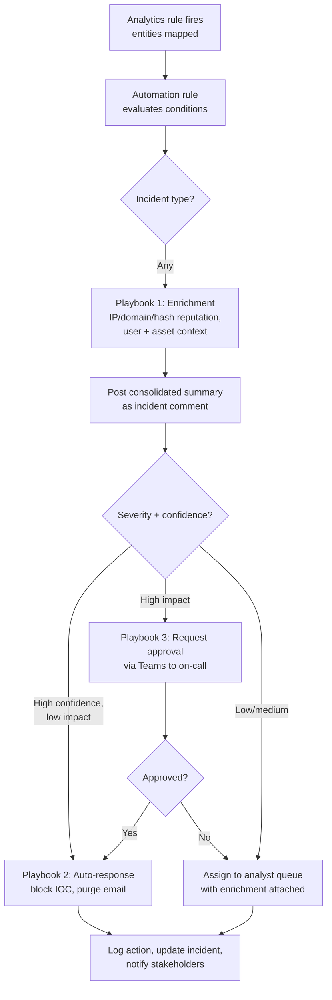

[← Back to index](README.md) | Tier 3 — Know the concepts

# Phase 23 — Automation / SOAR (Q491–500)

## 491. What is SOAR?
Security Orchestration, Automation and Response — a platform that connects security tools together and executes predefined workflows (playbooks) to handle repetitive response tasks: enrichment, notification, ticketing, and containment. Goal: cut manual effort and response time, and make the response consistent regardless of which analyst is on shift. In the Microsoft stack, SOAR is Sentinel automation rules plus Logic Apps playbooks.

## 492. SIEM vs SOAR?
Covered in [phase-11 Q257](phase-11-microsoft-sentinel.md#257-siem-vs-soar). Short version: **SIEM detects** (collect, correlate, alert); **SOAR responds** (orchestrate, automate, act). SIEM answers "what happened?"; SOAR answers "what do we do about it, without a human doing it by hand every time?"

## 493. What tasks should be automated in a SOC?
Automate the **repetitive, deterministic, and low-risk**:
- **Enrichment** — IP/domain/URL/hash reputation, WHOIS, geolocation, user and asset context, related incident lookup. Zero risk, highest time saving, and it makes every subsequent human decision better-informed.
- **Correlation and context-gathering** — pulling related alerts, prior incidents for the same entity, and the user's recent sign-in history into the incident automatically.
- **Ticket creation and updates** in the ITSM system.
- **Notification** — routing to the right owner, on-call escalation, Teams/email alerts.
- **Auto-closure of known-benign patterns** with documented, specific conditions.
- **Evidence collection** — gathering the standard log excerpts and screenshots for a given alert type.
- **Threat intel operations** — ingesting IOCs, checking indicator age, updating blocklists for high-confidence indicators.

The test to apply: *"is the decision deterministic, and is the action safe if the input is wrong?"*

## 494. What tasks should not be fully automated?
- **Investigation judgment** — deciding whether ambiguous activity is malicious requires context automation doesn't have.
- **High-impact containment without confidence** — isolating a production server or disabling a privileged account on a single low-confidence alert. A false positive here creates an outage.
- **Anything affecting critical business systems** — needs a human weighing business impact ([phase-17 Q419](phase-17-advanced-l2-investigation.md#419-what-if-containment-could-disrupt-a-critical-business-system)).
- **Communication with users, management, or external parties** — tone, accuracy, and context matter.
- **Evidence handling for legal/forensic purposes** — chain of custody needs human accountability.
- **Closing incidents that need analytical judgment** — auto-closing on a broad condition is how real attacks get silently dismissed.

The framing that lands well: *"automate the fetching, not the deciding"* — and where you do automate a decision, require high confidence and leave an audit trail and a rollback path.

## 495. How would you automate phishing investigation?
A high-value, well-bounded automation:
1. **Trigger** — user report (a report button feeding a shared mailbox) or a detection alert.
2. **Parse** the email — extract headers, sender, subject, URLs, attachment hashes.
3. **Enrich automatically** — sender domain reputation and age, SPF/DKIM/DMARC results, URL reputation and redirect chain, attachment hash reputation, and sandbox detonation of both URL and attachment.
4. **Scope automatically** — query the mail platform for all other recipients of the same campaign, and query click logs for who clicked.
5. **Post a consolidated verdict** to the incident as a comment with all of the above, so the analyst opens one incident and sees everything.
6. **Human decision point** — the analyst confirms malicious.
7. **Then automate the response** — purge from all mailboxes, block sender/domain/URL/hash across mail gateway, proxy, and firewall, and trigger password resets for confirmed credential submitters.
8. **Notify** the reporting user and any affected users.

Note the design: steps 1-5 are fully automatic, step 6 is a human gate, steps 7-8 are automated once approved. That gated shape is the answer interviewers want.

## 496. How would you automate IOC enrichment?
Trigger on incident creation, extract entities (IP, domain, URL, hash), query multiple TI sources **in parallel**, and post a consolidated summary back to the incident.

Design details worth mentioning, because they show production experience:
- **Query sources in parallel**, not sequentially, so one slow API doesn't stall the whole playbook.
- **Degrade gracefully** — if one source is rate-limited or errors, still post the results from the others rather than failing the whole run. (This repo's own `la-ip-enrichment` playbook is built this way.)
- **Store API keys in Key Vault** and read them at runtime via managed identity — never as playbook parameters or hardcoded values.
- **Cache/deduplicate** — don't re-query the same indicator repeatedly and burn your API quota.
- **Handle missing entities** — an incident with no IP entity shouldn't fail the playbook ([phase-21 Q470](phase-21-l2-troubleshooting.md#470-a-logic-app-failed-during-incident-automation-what-do-you-check)).

## 497. How would you automate user notification?
Trigger on specific incident types (phishing click, credential compromise, malware on their device), look up the user's manager from the directory, and send a templated message via email or Teams. Include what happened in plain language, what action was taken, what the user must do, and how to reach the SOC.

Cautions: **verify the recipient through a trusted channel** (don't reply to a potentially attacker-controlled mailbox), don't include sensitive investigation detail, throttle so a mass campaign doesn't send thousands of messages, and require human approval before notifying executives or external parties.

## 498. How would you automatically disable a compromised account?
Technically straightforward, operationally risky — and interviewers use this question to see whether you understand the risk:

**Mechanism:** a playbook with a managed identity holding Microsoft Graph `User.ReadWrite.All`, calling `PATCH /users/{id}` to set `accountEnabled: false`, plus `revokeSignInSessions` to kill active tokens (the reset alone doesn't — [phase-07 Q189](phase-07-identity-entra-id.md#189-what-is-token-theft)).

**The risks that make this a deliberate decision, not a default:**
- That permission is **unattended, tenant-wide, and can modify any user** — including every executive and admin. A compromise of the playbook or its identity is a serious escalation path.
- A **false positive locks out a real user** with no human in the loop; on a privileged or service account, that can cause an outage.
- Attackers can potentially **trigger it deliberately** to cause denial of service by making a target look compromised.

**Safer designs, in increasing order of automation:**
1. The playbook **posts a recommendation** as an incident comment; a human approves and acts. (This is the choice made in this repo's `la-user-containment` playbook — trading a little automation to avoid a standing tenant-wide Graph grant on an unattended identity.)
2. The playbook requests approval via Teams/email and acts only on confirmation.
3. Full automation restricted to **very high-confidence detections only**, on non-privileged accounts, with logging and a documented rollback.

Give the tradeoff explicitly — that's the L2 answer.

## 499. What risks exist with automated containment?
- **False positives cause outages** — an incorrectly isolated server or disabled account has real business cost.
- **Broad standing permissions** — automation identities need powerful, always-available rights, making them an attractive target and a privilege-escalation path.
- **Attacker-triggered automation** — an adversary who understands your playbooks can deliberately trigger containment to cause disruption, or trigger noisy false positives to distract the SOC.
- **Cascading actions** — one automated action triggering another, amplifying an error across the estate.
- **Evidence destruction** — automated remediation that deletes files or reimages a host before it's been preserved.
- **Loss of visibility** — cutting off C2 immediately can tip the attacker off before you've scoped the intrusion.
- **Over-trust** — analysts assuming the automation handled it and not verifying.

**Mitigations:** confidence thresholds, approval gates for high-impact actions, scope limits (never on critical assets or privileged accounts automatically), least-privilege automation identities, full audit logging, tested rollback procedures, and regularly reviewing what the automation actually did.

## 500. How would you design a Sentinel + Logic Apps automation workflow?
Structure the answer as a design, not a feature list:

**Design principles to state:**
1. **Enrich first, always** — every incident gets context automatically, regardless of what happens next.
2. **Gate by confidence and impact** — automation acts alone only where both are favorable.
3. **Least privilege** — a **managed identity** per playbook with only the roles that playbook needs (Sentinel Responder to comment, Key Vault Secrets User for API keys); no shared over-privileged identity, no secrets in the workflow.
4. **Secrets in Key Vault**, read at runtime.
5. **Fail gracefully** — handle missing entities and API failures without breaking the run.
6. **Audit everything** — every automated action written back to the incident so the analyst sees what happened.
7. **Version control the definitions** — export as ARM templates and keep them in source control so changes are reviewable and deployment is repeatable.
8. **Test in a non-production workspace** before deploying, and monitor run history for failures.

---
[← Back to index](README.md) · [← Phase 22](phase-22-detection-engineering.md) · [Next: Phase 24 — Behavioral Questions →](phase-24-behavioral-questions.md)
